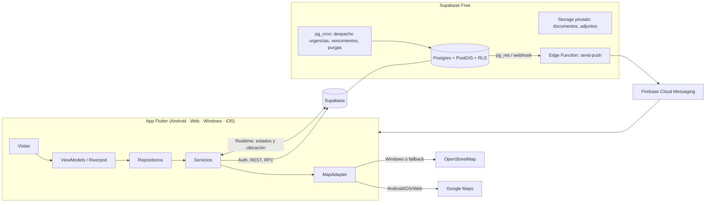
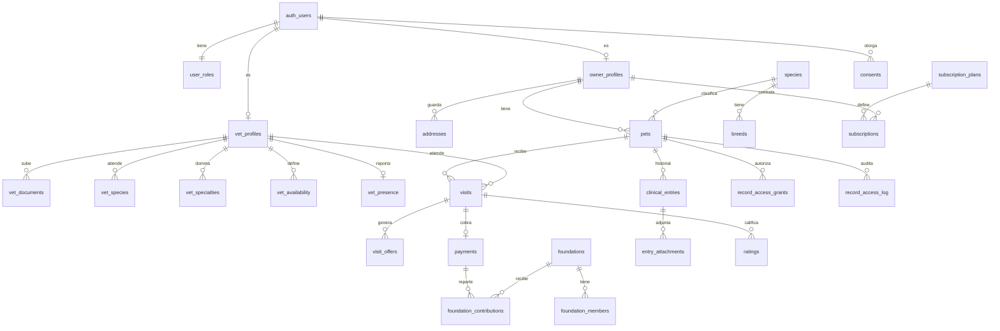
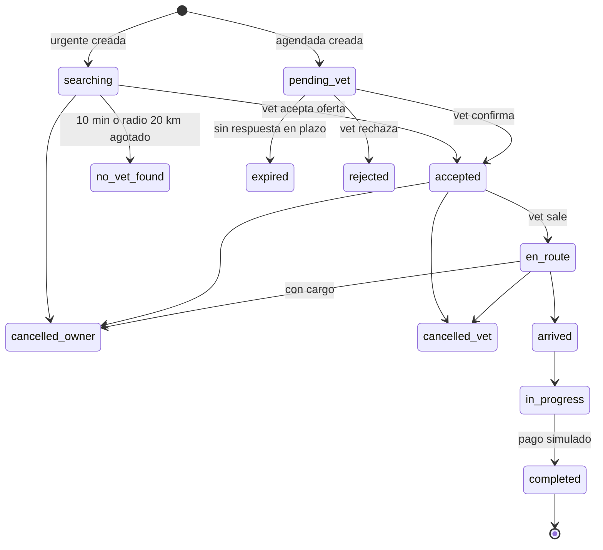

# Arquitectura — Proyecto Felix (v1)

> Estado: borrador v1 para aprobación · Fecha: 2026-11-16 · Requisitos: [SPEC.md](../SPEC.md)

## 1. Stack elegido y por qué

| Capa | Elección | Por qué |
|---|---|---|
| App | **Flutter 3.47** (Android, Web, Windows, iOS) | Un solo código para las 4 plataformas pedidas. |
| Estado | **Riverpod** | Se testea sin `BuildContext`, maneja bien streams (Realtime) y permite sobrescribir dependencias en los tests. |
| Rutas | **go_router** | Rutas declarativas, deep links y URLs limpias en Web, y protección de rutas por rol. |
| Modelos | **freezed + json_serializable** | Modelos inmutables, igualdad por valor y `copyWith`. |
| Backend | **Supabase (nivel gratuito)**: Postgres 17, Auth, Storage, Realtime, Edge Functions y Cron | Ver la comparación en §2. |
| Geo | **PostGIS** (`geography(Point)`, `ST_DWithin` y un índice GiST) | Matching por cercanía dentro de la base de datos. |
| Mapas | **Google Maps** como principal y **OpenStreetMap** (`flutter_map`) como alternativa, detrás de `MapAdapter` | `google_maps_flutter` **no soporta Windows**, así que en Windows el adaptador usa OSM. |
| Push | **Firebase Cloud Messaging** (gratuito), solo para notificaciones | Android, iOS y Web. Windows no tiene FCM y usa avisos dentro de la app vía Realtime. |
| CI | **GitHub Actions** (gratis en repos públicos; 2.000 min/mes en privados) | Corre `analyze`, `test` y pgTAP en cada push. |
| Tests | `flutter_test`, `integration_test`, **pgTAP** (`supabase test db`) | La seguridad (RLS) y las reglas de negocio se prueban en la base de datos. |

Paquetes principales (las versiones se fijan en `pubspec.lock` en la fase 0): `supabase_flutter`, `flutter_riverpod`, `go_router`, `freezed`, `json_serializable`, `google_maps_flutter`, `flutter_map`, `latlong2`, `geolocator`, `firebase_messaging`, `file_picker`, `image` (compresión).

> **`supabase_flutter` v3** salió el 2026-11-06 con cambios incompatibles con v2. En la fase 0 se decide la versión: v3 si su API ya está estable en pub.dev; si no, v2.x fijada.

## 2. Backend: ¿por qué Supabase?

| Criterio | **Supabase (Free)** | Firebase (Spark) | Local (Postgres o PocketBase en tu PC) |
|---|---|---|---|
| Seguridad de la ficha clínica | **RLS en SQL**: reglas por fila, auditables y testeables con pgTAP. Incluye joins y vencimientos de acceso | Security Rules: posibles, pero las consultas relacionales (acceso por visita y vencimiento) son incómodas y se testean con un emulador | Total control, pero toda la autorización se programa a mano |
| Cercanía en tiempo real | **PostGIS** + Realtime (Postgres Changes y Broadcast privado) | Geohash manual en Firestore; las consultas por radio son aproximadas | PostGIS posible; el tiempo real habría que montarlo |
| Lógica en servidor | Funciones SQL, **pg_cron** y Edge Functions (500.000 invocaciones/mes) incluidos | **Cloud Functions requiere el plan Blaze (con tarjeta)** | Sí, pero sin hosting público |
| Límites gratuitos | 500 MB de BD, 1 GB de archivos, 5 GB de egress, 50.000 MAU, 200 conexiones Realtime, 2 M de mensajes/mes, **se pausa tras 1 semana sin uso** | Generosos en lecturas y escrituras, pero sin funciones de servidor | Sin límites, pero no es accesible desde celulares fuera de tu red |
| Modelo de datos | Relacional: encaja con visitas, pagos, fichas y fundaciones | Documental: totales y joins más difíciles | Relacional |

**Decisión: Supabase confirmado.** Es la única opción gratuita con autorización por fila en SQL, geoconsultas reales y jobs programados sin tarjeta. Desarrollamos contra Supabase **local** (CLI + Docker) y desplegamos al proyecto gratuito en la nube.

Cambios recientes de Supabase que afectan el diseño (changelog 2026):

- Las tablas nuevas de `public` **ya no se exponen** a la Data API por defecto: cada migración incluye `grant` explícitos además de la RLS.
- El esquema `realtime` está bloqueado. Para la autorización de canales privados se usan políticas sobre `realtime.messages`.
- Los proyectos Free nuevos con el SMTP por defecto no pueden personalizar los correos de Auth. Se acepta el correo estándar (o un SMTP gratuito más adelante).

## 3. Diagrama general



### Capas en Flutter (skill `flutter-apply-architecture-best-practices`)

```text
lib/
├── core/            # config (env), router, theme, errores, Result
├── data/
│   ├── services/    # SupabaseService, StorageService, PushService, GeoService
│   ├── maps/        # MapAdapter (interfaz) + GoogleMapAdapter + OsmMapAdapter
│   └── repositories/# AuthRepo, PetRepo, VisitRepo, RecordRepo, PaymentRepo, CatalogRepo...
├── domain/
│   ├── models/      # freezed: Pet, Visit, ClinicalEntry, Quote, Plan...
│   └── use_cases/   # solo donde haya lógica cruzada (p. ej. RequestUrgentVisit)
└── ui/
    ├── core/        # widgets compartidos
    └── features/{auth,owner,vet,admin,foundation,record,visit}/{views,view_models}
```

Se adapta la guía oficial cambiando `ChangeNotifier` por Notifiers de Riverpod. Los repositorios exponen modelos de dominio y la UI nunca llama a Supabase directamente.

**`MapAdapter`**: interfaz con `buildMap(center, markers, polylines, onTap)`, `animateTo` y `geocode`/`reverseGeocode` (detrás de `GeocodingAdapter`). Se elige con `MAP_PROVIDER=google|osm` en el entorno y por plataforma: en Windows siempre OSM. Un test de contrato corre la misma suite sobre ambas implementaciones.

Implementación (fase 4, `lib/data/maps/`):

- `MapAdapter.buildMap(...)` + `MapViewController.animateTo`. `GoogleMapAdapter` (Android y Web; en Web el SDK JS se inyecta en tiempo de ejecución con la clave de `--dart-define`, y en Android la clave llega al manifiesto desde los dart-defines) y `OsmMapAdapter` (`flutter_map`, URL de tiles configurable con `OSM_TILE_URL`; en producción Stadia o MapTiler).
- iOS usa OSM hasta probar en un Mac la clave nativa (`GMSServices.provideAPIKey`).
- `GeocodingAdapter.search/reverse`: `GoogleGeocodingAdapter` (REST, solo Android) y `NominatimGeocodingAdapter` (Web siempre, porque la API REST de Google no admite CORS). Ambos van detrás de `CachingGeocodingAdapter` (LRU de 100 entradas + deduplicación). Nominatim además usa una cola con 1,1 s entre peticiones y un User-Agent genérico de la app (en Web, el navegador manda el Referer). La UI aplica debounce de 700 ms a la búsqueda y de 900 ms a la geocodificación inversa.
- Tests de contrato sin red: `MockClient` para el geocoding, un `TileProvider` offline para OSM y una `GoogleMapsFlutterPlatform` falsa para Google.

**Mascotas y direcciones (fase 4):**

- `pets` y `addresses`: solo el dueño lee y escribe (rol `owner`). El admin no las ve (minimización), y el vet tampoco: la ficha llega en la fase 7 vía `get_pet_record` y la dirección del vet asignado, en la fase 6.
- Sin DELETE: se desactivan (`active`). Topes de 20 mascotas y 10 direcciones activas por dueño (con advisory lock).
- `private.guard_pet` valida que la especie esté activa y que la raza pertenezca a la especie (solo al crear o al cambiarlas: desactivar una especie no bloquea las mascotas existentes) y que la fecha de nacimiento no sea futura.
- `addresses.location geography(Point)` es columna **generada** desde `lat`/`lng` y tiene un índice GiST.
- **Coherencia entre punto y comuna (QA-F4-01/02):**
  - `public.commune_boundaries` guarda los límites simplificados de 345 comunas, con licencia CC BY 3.0 IGO. Vienen de geoBoundaries `gbOpen CHL ADM3`, versión `9469f09`, de origen BCN y OCHA ROLAC. La fuente, el SHA-256 y el procesamiento se citan en la migración `commune_boundaries`.
  - `private.guard_address` exige que el punto esté a 2,5 km o menos del límite de la comuna elegida. El error máximo medido de la simplificación es de 2,09 km. Fuera de toda comuna, el mensaje es "La ubicación debe estar en Chile".
  - Antártica no tiene polígono en la fuente. Para ella se acepta el Territorio Chileno Antártico (Decreto 1747 de 1940, entre 53° y 90° O), al sur de 60° S.
  - La RPC `communes_at_point` (SECURITY INVOKER) ordena las comunas compatibles por profundidad dentro del límite. La UI propone con ella la comuna del punto marcado y solo ofrece las compatibles.
  - El centro de cada comuna (`ST_PointOnSurface`) centra el mapa sin consultar al geocoder.
  - Límite conocido: en zonas urbanas, a menos de 2,5 km de un borde también se acepta la comuna vecina.
- **Geocoding de Google:** se usa solo en Android y solo con `GOOGLE_GEOCODING_API_KEY`, una clave propia restringida por API y con cuota. La clave del mapa, restringida a la app, no sirve: la API REST la rechaza sin las cabeceras `X-Android-Package` y `X-Android-Cert`. Por defecto se usa Nominatim.
- `private.address_approx(address, from)` devuelve la comuna y la distancia redondeada a 0,5 km para las ofertas de la fase 6. No tiene EXECUTE para la app.

**Precios, pagos simulados y fundaciones (fase 5):**

- **Cotización:** `quote_visit(pet, address, specialty, mode, vet?, foundation?, extra_donation)` no recibe montos. Valida dueño, mascota, dirección, especie↔especialidad (`species_specialties`) y vet (aprobado, con la especie y la especialidad), y guarda una fila **inmutable** en `quotes` (vigencia de 30 min, tope de 60 por dueño y hora) con la versión de `pricing_config` usada. Devuelve el snapshot JSON (`private.quote_snapshot`), que es lo que la fase 6 guardará en `visits.quote`.
- **Contrato con la fase 6:** `private.consume_quote(quote_id, owner)` bloquea la cotización (`for update`), verifica dueño, vigencia y que no esté usada, y la marca `consumed_at`. `private.quote_for(..., p_origin)` es el núcleo reutilizable (por ejemplo, para recotizar una urgencia con la presencia del vet en la fase 8). Ninguno de los dos tiene EXECUTE para la app.
- **Distancia (QA-F5-01/02):** `ST_Distance(addresses.location, vet_bases.quote_origin)` en metros. `vet_bases` es el punto de partida del vet (solo lo lee el propio vet; se valida contra `commune_boundaries` como las direcciones; la UI llega con la agenda). `quote_origin` es la base desplazada **1–2 km con rumbo aleatorio, fijado al crear la base** (`fuzz_dlat`/`fuzz_dlng`, sin grant de escritura): redondear no basta, porque moviendo su dirección y mirando dónde cambia el valor redondeado o los km facturables un dueño recupera la distancia exacta con pocas cotizaciones (tope 60/h). Así lo máximo trilaterable es el punto falso y la base real queda en un anillo de 1–2 km (~9,4 km²); el costo es ±2 km de recargo (±$1.000). `quotes.distance_m` no es legible por la API (grant por columna) y el cliente recibe `distance_km` al km. Tope `pricing_config.max_distance_km` (30 km por defecto: cruza el Gran Santiago, recargo máximo ~$12.500); sobre eso, la cotización se rechaza. Sin vet (urgencia antes de aceptar), la distancia queda pendiente y el recargo es 0.
- **Fórmula y redondeo** (`private.price_breakdown`, pura): urgencia = `clp_round(base × urgent_pct)`; km facturables = `ceil((m − free_km·1000)/1000)` (mínimo 0); descuento = `clp_round(base × discount_pct)` o la base completa si es preventiva incluida; servicio = base − descuento + urgencia + km × per_km; comisión = `clp_round(lista × commission_pct)`; fundación = `clp_round(comisión × foundation_pct)`; **vet = lista − comisión** (cuadra al peso); total = servicio + donación, con lista = servicio + `plan_subsidy` (= servicio sin plan, §5.2). `clp_round` = mitad hacia arriba.
- **Pagos:** `payments.provider` solo admite `simulated`; estados `pending → simulated_paid | simulated_failed`. Montos inmutables (trigger, incluso para SQL interno) y con `check` de cuadratura. `payment_events` guarda cada cambio de estado y, al pagarse, un trigger crea `foundation_contributions` (`commission_share`, `donation`). `simulate_payment(quote_id, simulate_failure)` es la única vía de pago; un fallo no consume la cotización (máx. 5 intentos).
- **Fundaciones:** `foundations` (una sola `is_default`, que debe estar activa; `set_default_foundation` es atómica y solo admin), `foundation_members` (rol `foundation`, los crea el admin por SQL) y `owner_profiles.foundation_id` (elección del dueño; si es null o queda inactiva, se usa la por defecto). Los miembros **no** leen `payments` ni `foundation_contributions`: solo `foundation_summary()` (totales por mes, zona `America/Santiago`).
- **RLS:** el dueño ve sus cotizaciones y pagos; el admin, todo; vets y fundaciones, nada de pagos (SPEC HU8.6).
- **Precio de lanzamiento:** consulta general a domicilio $26.990 todo incluido hasta 5 km (10 % bajo los $30.000 habituales), migración `20261117210000_general_tariff_26990`: comisión $4.049, fundación $810, vet $22.941. Preparado sin activar: `pricing_config.commission_on_distance` (`false` = el recargo por km va 100 % al vet). El incentivo de $500 por transferencia sigue sin definirse.

## 4. Modelo de datos

Convenciones: `uuid` como PK en tablas expuestas (evita IDs predecibles), `bigint identity` en logs internos, `timestamptz`, montos en **CLP `integer`**, `text` con `check` para estados, índice en toda FK y en toda columna usada por RLS. RLS habilitada y forzada en **todas** las tablas.



### Entidades

| Grupo | Tabla | Campos clave |
|---|---|---|
| Identidad | `user_roles` | `user_id` PK, `role` (`owner`,`vet`,`foundation`,`admin`). Solo la escribe el admin o el trigger de registro. |
| | `owner_profiles` | `user_id`, `display_name`, `phone` (visible solo para el vet asignado durante la visita), `commune_id`. **Sin RUT.** |
| | `terms_acceptances`, `privacy_notice_views` | `user_id`, `version`, `at` (contrato y deber de información; no son consentimiento) |
| | `consents` | `user_id`, `purpose` (solo opcionales: `marketing`, ...), `version`, `granted_at`, `revoked_at` |
| | `deletion_requests` | `user_id`, `requested_at`, `execute_after` (+15 d), `status` (`blocked`,`executing`,`done`,`cancelled`) |
| | `deletion_targets` | `request_id`, `system` (`db`,`storage`,`fcm`,`logs`), `action`, `ack_at`, `verified_at`, `retained_reason` |
| | `security_incidents` | registro de brechas: `detected_at`, `severity`, `affected`, `notified_agency_at`, `notified_subjects_at` |
| Ubicación | `regions`, `communes` | catálogo nacional |
| | `addresses` | `owner_id`, `label`, `street_text`, `commune_id`, `location geography(Point)` |
| Mascotas | `species`, `breeds`, `specialties`, `species_specialties` | catálogos con `active` |
| | `pets` | `owner_id`, `name`, `species_id`, `breed_id`, `sex`, `birth_date_approx`, `microchip` (opcional) |
| Veterinarios | `vet_profiles` | `user_id`, `display_name`, `status` (`pending`,`approved`,`rejected`,`suspended`), `identity_verified_at`, `verified_by`, `rating_avg` y `cancel_count_30d` (fase 9: se calculan al consultar con `private.rating_stats` y `private.vet_cancel_count_30d`; no son columnas). **Sin RUT en el MVP** (si llegan pagos reales: `private.vet_identity`, solo admin). |
| | `vet_documents` | `vet_id`, `kind` (`degree`,`id_card`), `storage_path` (se anula al purgar), `review_status`, `reviewed_by`, `reviewed_at`, `purge_after` |
| | `vet_species`, `vet_specialties` | tablas puente |
| | `vet_availability`, `vet_time_off` | bloques semanales (`weekday`, `start_time`, `end_time`) y rangos `tstzrange` |
| | `vet_presence` | `vet_id`, `online`, `location geography`, `updated_at`. **No es legible por la API**: solo la usan funciones internas. |
| Visitas | `visits` | `owner_id` (nullable, para anonimizar), `pet_id` (nullable), `vet_id`, `mode` (`urgent`,`scheduled`), `status`, `address_id` (nullable), `commune_id`, `species_id`, `specialty_id`, `slot tstzrange`, `search_radius_km`, `search_started_at`, `quote jsonb` (congelado), `foundation_id`, `cancel_reason`, `is_preventive` |
| | `visit_offers` | `visit_id`, `vet_id`, `batch_no`, `radius_km`, `distance_km_rounded`, `expires_at`, `response` (`pending`,`accepted`,`rejected`,`expired`,`void`) |
| Pagos | `pricing_config` | versión con `effective_from`: `commission_pct`, `foundation_pct`, `urgent_pct`, `per_km`, `free_km`, `cancel_fee` |
| | `tariffs` | `species_id`, `specialty_id`, `base_price` |
| | `payments` | `visit_id`, `kind` (`visit`,`cancel_fee`,`subscription`), `service_price`, `platform_fee`, `foundation_share`, `vet_payout`, `extra_donation`, `total`, `status` (siempre `simulated_paid`) |
| | `foundations`, `foundation_members`, `foundation_contributions` | aportes: `payment_id`, `foundation_id`, `kind`, `amount`, `created_at` |
| Suscripciones | `subscription_plans`, `subscriptions`, `subscription_pets` | `discount_pct`, `preventive_per_year`, `waive_urgent`, `max_pets`, `price_monthly`; uso del cupo calculado desde `visits.is_preventive` |
| Ficha | `clinical_entries` | `pet_id`, `visit_id`, `author_id`, `author_role` (`vet`,`owner`), `kind` (`consultation`,`vaccine`,`diagnosis`,`note`), `specialty_id`, `species_id` (snapshot), `body jsonb`, `vaccine_next_due`, `supersedes_id`, `created_at`, `retain_until` (solo en entradas desvinculadas tras un borrado). **Solo inserción** (la desvinculación la hace únicamente el job de borrado). |
| | `entry_attachments` | `entry_id`, `storage_path`, `mime`, `size_bytes` |
| | `record_access_grants` | `pet_id`, `vet_id`, `source` (`visit`,`owner`), `visit_id`, `starts_at`, `expires_at` (null = mientras la visita esté activa), `revoked_at` |
| | `record_access_log` | `bigint`, `pet_id`, `entry_id`, `actor_id`, `action` (`view`,`create`,`correct`,`export`,`grant`,`revoke`), `at`. Solo inserción y sin datos clínicos. |
| Otros | `ratings` | `visit_id`, `rater_id`, `ratee_id`, `rater_role`, `stars` (1–5), `comment` (≤ 500), `hidden`, `published_at`, `created_at`; única por `(visit_id, rater_id)`. Sin acceso directo: solo RPC (fase 9) |
| Otros | `vet_cancel_alerts` | `vet_id`, `cancel_count`, `first_cancel_at`, `last_cancel_at`, `reviewed_at`, `reviewed_by`; una abierta por vet. Solo RPC del admin |
| | `device_tokens` | `user_id`, `token`, `platform` |
| | `emergency_clinics` | catálogo admin: nombre, comuna, teléfono, 24 h |
| | `admin_audit_log` | acciones del admin |

Restricciones destacadas:

- **Sin doble reserva:** `exclude using gist (vet_id with =, slot with &&) where status in (activos)` (requiere `btree_gist`). El `slot` incluye el margen de traslado.
- **Aceptación de urgencia:** la RPC `accept_offer(offer_id)` hace `select ... for update` sobre la visita, verifica `status = 'searching'` y la oferta `pending` y no vencida, asigna el vet y anula las demás ofertas. Es atómica, así que en caso de empate gana el primero.

## 5. Máquina de estados de la visita



Las transiciones se validan en la función `private.transition_visit(visit_id, to_status)`, que verifica el rol del actor y que el cambio sea un borde permitido. El cliente nunca hace `update` directo sobre `status`.

**Fase 6 (implementado):** se suma el borde `pending_vet → cancelled_owner` (el dueño retira una solicitud sin costo). El vet asignado confirma, rechaza, sale (desde 2 h antes), llega, inicia, completa o cancela; el dueño solo cancela (cargo según `private.cancel_fee_for`); el sistema expira (`pending_vet → expired` al vencer `confirm_deadline = min(creación + 12 h, hora − 2 h)`) y cierra como `cancelled_vet`, sin cargo, una visita `accepted` que no pasó a "en camino" 1 h después de su hora. Cada cambio queda en `visit_events`. El pago simulado ocurre después de `completed` (`simulate_payment(visit_id)`).

**Correcciones de QA fase 6 (`20261118124201_qa_f6_fixes.sql`, constantes en `private.visit_timing()`):**
- "Llegó" e "inicia" solo desde **30 min antes** de la hora; "completada" con al menos **10 min** de atención (`visits.started_at`).
- Una visita `en_route` o `arrived` que sigue así **2 h después** de la hora se cierra sola como `cancelled_vet`, sin cargo. Nuevo borde `arrived → cancelled_vet` (el vet o el sistema).
- Si el vet va "en camino" y ya pasaron **30 min** de la hora, el dueño cancela **sin cargo**.
- Sin punto de partida (`vet_bases`) no hay cotización con ese vet ni reserva (la cotización debe tener distancia).
- `available_vets` preselecciona por KNN los 30 vets compatibles más cercanos a `quote_origin`, calcula sus horarios en una consulta por vet y devuelve hasta 20; tope de **30 búsquedas por dueño y minuto** (`private.search_quota`).
- El admin no lee `visit_events` (solo `admin_visit_summary`).
- **Seguimiento (`20261118181914_qa_f6_followup.sql`).** QA-F6-07: los vets con un día libre que cubre todo el día pedido no son candidatos, y los candidatos se ordenan por distancia (KNN) y se recorren en bloques de 40 (horarios en una consulta por bloque) hasta reunir 20 con horario libre o agotar el radio; ya no hay un tope fijo de 30 candidatos. Peor caso medido (300 vets sin horario + 300 con día libre + 5.000 visitas): 67–95 ms. QA-F6-06: una visita `in_progress` se cierra sola como **`completed`** (actor nulo = sistema) a las **6 h del inicio o 8 h de la hora agendada**, lo primero (`private.visit_progress_limits()`). Se eligió `completed` porque la atención sí empezó; no hay cobro automático: el dueño paga (simulado) desde la app. La dirección exacta y el teléfono dejan de entregarse apenas vence la ventana activa de cada estado (`private.visit_active_until`), aunque el cron todavía no la cierre.
- `scheduled_at`, `slot`, `confirm_deadline` y `started_at` son inmutables. Solo una sesión directa de `postgres` con `felix.time_travel = 'on'` los mueve (pgTAP y E2E vía `tool/e2e/sql.mjs`); la API conecta como `authenticator` y no puede.

### 5.1 Fase 9 (implementado): cancelaciones y calificaciones

Migración `20261125180000_ratings_cancellations.sql`; test `200_ratings_cancellations.test.sql` (86 casos). Constantes en `private.rating_rules()`.

- **Calificar** (`rate_visit(p_visit_id, p_stars, p_comment = null)` → mismo JSON que `visit_rating_status`): solo el dueño y el vet asignado de una visita `completed` (también si la cerró el sistema), una vez cada uno (23505), de 1 a 5 estrellas y comentario de hasta 500 (22023), antes de `completed_at + 168 h` (22023). Visita ajena o inexistente: 42501. Bloquea la visita (`for update`) para que dos calificaciones simultáneas se vean. Cuenta propia bloqueada: 42501 `account_blocked`; contraparte bloqueada: 22023 `counterpart_blocked` (HTTP 400, para que la app no confunda el bloqueo ajeno con el propio).
- **Publicación diferida por consulta (sin pg_cron):** la contraparte ve una calificación desde `coalesce(published_at, completed_at + 168 h)` (`private.rating_public_at`); `rate_visit` fija `published_at = now()` en ambas cuando califica el segundo. Las ventanas van en horas para que el cambio de horario de Chile no las mueva.
- **Lectura (solo RPC; `ratings` no tiene grants):**
  - `visit_rating_status(p_visit_id)` → `{visit_id, my_role, rate_until, can_rate, mine: {stars, comment, hidden, created_at, publishes_at} | null, theirs: {stars, comment, comment_hidden, published_at} | null}`.
  - `my_ratings_received(p_limit = 50)` → filas `{visit_id, rater_role, stars, comment, comment_hidden, published_at}` (sin quién calificó).
  - `my_rating_summary()` → `{rating_avg, rating_count, min_ratings, cancel_count_30d}` (el contador solo para vets).
  - `vet_rating_summary(p_vet_id)` → `{vet_id, rating_avg, rating_count}` de un vet aprobado y no bloqueado (si no, `null`).
  - Se excluyen las calificaciones de cuentas bloqueadas.
- **Moderación:** `hidden` oculta el **comentario** (SPEC: "ocultar comentarios"); las estrellas siguen visibles y cuentan. `admin_list_ratings(p_limit = 100)` (también las no publicadas; sin cuentas bloqueadas) y `admin_set_rating_hidden(p_rating_id, p_hidden = true)`; queda en `admin_audit_log` (trigger `ratings_audit`).
- **Promedio:** solo publicadas, del dueño hacia el vet y sin cuentas bloqueadas; con menos de 3 es `null` y el despacho usa 3,0 (§6).
- **Cancelaciones del vet (HU7.4):** `private.vet_cancel_count_30d` cuenta las `cancelled_vet` con `closed_at` en las últimas 720 h, tanto las del vet como las que cerró el sistema por no marcar "en camino" o no avanzar (son incumplimiento: SPEC "tasa de cumplimiento"). El trigger `visits_vet_cancel_alert` abre (o actualiza) una alerta en `vet_cancel_alerts` con 3 o más; no lo hace para un vet bloqueado. Admin: `admin_list_cancel_alerts(p_include_reviewed = false)` → filas `{id, vet_id, vet_name, cancel_count, cancel_count_30d, first_cancel_at, last_cancel_at, created_at, reviewed_at}` y `admin_review_cancel_alert(p_alert_id)` (auditado). Ya revisada, la siguiente cancelación con 3 o más abre otra.
- **Cargos (HU7.3):** sin cambios. Las reglas de la fase 6 (`private.cancel_fee_for`, `cancel_free_hours` de la versión congelada) quedan cubiertas por una tabla pgTAP por estado, modo y hora, más el pago `cancel_fee`. La cancelación del vet no tiene cargo.
- **Privacidad:** `export_my_data` agrega `ratings_given` (todas), `ratings_received` (solo publicadas; el comentario oculto sale como `null`) y, para el vet, `cancel_alerts`. `private.erase_subject` borra las calificaciones hechas y recibidas y las alertas del vet (pasos en `deletion_targets`).
- **App:** `RatingRepository` → `rating_providers.dart`. Tarjeta "Calificar" en el detalle de la visita completada (dueño; el vet la abre desde su lista con "Calificación"), resumen y calificaciones recibidas con el contador de cancelaciones en el perfil del vet, promedio público al elegir vet en "Agendar visita" (`vet_rating_summary` por vet) y pestañas "Calificaciones" y "Alertas de cancelación" en el panel del admin.

### 5.2 Fase 10 (implementado): suscripciones simuladas

Migración `20261125200000_subscriptions.sql`; test `210_subscriptions.test.sql` (107 casos, 22 de tabla de precios con plan, urgencia, preventiva y distancia, más la matriz de accesos).

- **Catálogo** `subscription_plans` (`slug`, `name`, `discount_pct`, `preventive_per_year`, `waive_urgent`, `max_pets`, `price_monthly`, `sort`, `active`): Básico (10 %, 1 preventiva, 1 mascota, $4.990), Plus (20 %, 2, sin recargo de urgencia, 1, $9.990) y Familia (20 %, 2, sin recargo, 4, $14.990). Lectura de los activos para autenticados (el admin ve todos); el admin inserta y edita (UPDATE por columna) con `admin_audit_log`; no se borran, se desactivan. Un plan desactivado no se contrata ni se renueva (sus suscriptores conservan el período pagado). Cambiar un plan vale para cotizaciones nuevas y, el precio, desde la próxima renovación.
- **Período (hora de Chile):** `[current_period_start, current_period_end)` en fechas de `America/Santiago`, anclado al alta: el período n termina en `started_on + n meses` (31-ene → 28-feb → 31-mar). Estados: `active` → `cancelled` (no se renueva; beneficios mientras la fecha de Chile < `current_period_end`) → `ended`. Índice único parcial: una sola abierta (`status <> 'ended'`) por dueño.
- **Renovación simulada:** pg_cron `renew-subscriptions` (minuto 7 de cada hora) ejecuta `private.renew_subscriptions()`: con la fecha de Chile ≥ `current_period_end`, las canceladas, las de cuentas bloqueadas y las de planes desactivados pasan a `ended` sin cobro; las activas avanzan un período por cada uno vencido y registran un pago `subscription` (`period_start`, único por suscripción y período). Mientras el cron no corre, una activa sigue con beneficios (la renovación simulada siempre se cobra).
- **Pago `subscription`:** `service_price = platform_fee = total = price_monthly`; `vet_payout`, `foundation_share`, `extra_donation` y `plan_subsidy` en 0 (sin aporte a la fundación). `foundation_id` es la del dueño o la por defecto solo porque `payments` lo exige.
- **RPC (SECURITY INVOKER → `private`, solo rol `owner`; 42501 si no):**
  - `subscribe(p_plan_id integer, p_pet_ids uuid[])` → vista. Plan activo; mascotas: al menos una, sin repetir, hasta `max_pets`, propias y activas (22023). Con una activa: 22023 "Ya tienes una suscripción activa…"; una cancelada vigente se cierra (`ended`) y la nueva empieza hoy. Cobra el primer mes.
  - `set_subscription_pets(p_pet_ids uuid[])` → vista. Reemplaza las mascotas de la suscripción abierta (mismas validaciones).
  - `cancel_subscription()` → vista. Solo una `active` (22023 si no).
  - `my_subscription()` → vista o `null` (también `null` para otros roles).
  - Vista: `{id, status, plan: {id, slug, name, discount_pct, preventive_per_year, waive_urgent, max_pets, price_monthly}, started_on, periods_paid, current_period_start, current_period_end (exclusivo), renews, cancelled_at, benefits_active, preventive_used, preventive_remaining, pets: [{pet_id, name, active}]}`.
- **Beneficios en la cotización** (`private.plan_benefits`, aplicado por `private.quote_for`, o sea `quote_visit` y `request_urgent_visit`): solo si la mascota está asociada a una suscripción con beneficios. Descuento = `clp_round(base × discount_pct)`; `waive_urgent` omite el recargo de urgencia; **preventiva incluida** = visita **agendada** de la especialidad `prevencion` con cupo libre: descuento = base completa (base $0; la distancia se cobra). Cupo: `preventive_per_year` del plan vigente contra las visitas `is_preventive` del dueño (abiertas o completadas; canceladas, rechazadas y expiradas lo devuelven) creadas en los **últimos 12 meses** de Chile, sumando todas sus suscripciones (cancelar y volver a contratar no lo reinicia). Agotado el cupo, se cobra normal (con el descuento del plan).
- **Congelado:** `quotes` guarda `subscription_id`, `plan_id`, `plan_name`, `plan_discount_pct`, `plan_waive_urgent`, `is_preventive` y `plan_subsidy` (inmutables por `guard_quote_update`); el snapshot (`visits.quote`) agrega `plan` (`{plan_id, name, discount_pct, waive_urgent}` o `null`), `is_preventive` y `plan_subsidy`. En urgencias, `urgent_price`/`accept_offer` usan el plan congelado en la solicitud y su versión de `pricing_config`. Al crear la visita, el trigger `visits_plan` copia `is_preventive` y revalida (serializado por dueño) que el plan siga vigente y, si es preventiva, que quede cupo; si no, 22023 "Tu plan cambió desde la cotización…" (hay que volver a cotizar).
- **Subsidio (decisión a confirmar por el usuario):** el descuento y el recargo omitido los absorbe la plataforma (`plan_subsidy = precio de lista − servicio`). Comisión, aporte a la fundación y **pago al vet se calculan sobre el precio de lista** (lo que pagaría un dueño sin plan): el vet nunca cobra menos por atender a un suscriptor, y en una preventiva incluida cobra la tarifa completa. Neto de la plataforma en la visita = comisión − subsidio (puede ser negativo; lo cubren las cuotas). Restricciones: `platform_fee + vet_payout = service_price + plan_subsidy` en `quotes` y `payments`. Sin plan, todo es idéntico a la fase 5.
- **Privacidad:** `subscriptions` solo la lee su dueño; `subscription_pets` también (ni el admin, por minimización: ve los pagos `subscription`). Vets y fundaciones no leen el plan: `my_visits`, `my_offers`, `my_payouts` y la exportación del vet muestran `service_price` de lista (servicio + subsidio), sin `plan` ni subsidio. `export_my_data` del dueño agrega `subscriptions` (con `pet_ids`) y `plan_subsidy`/`subscription_id`/`period_start` en `payments`; `private.erase_subject` borra las suscripciones y sus mascotas (paso en `deletion_targets`) y los pagos quedan anonimizados.
**Fase 10 en la app (Flutter):** `SubscriptionRepository` (`lib/data/repositories/subscription_repository.dart`; planes por SELECT a `subscription_plans` activos, el resto por RPC), ViewModels en `lib/ui/features/owner/view_models/subscription_providers.dart` y la vista "Mi plan" (`/owner/plan`, desde Mi perfil). Sin plan muestra el catálogo; con uno activo, período, cupo de preventivas, mascotas ("Cambiar mascotas") y "Cancelar plan" (para cambiar de plan hay que cancelar antes); con uno cancelado vigente ofrece contratar otro (el actual termina hoy). `QuoteBreakdown` muestra el descuento del plan, la preventiva incluida, la urgencia sin recargo y la línea "Cubierto por Felix (tu plan)" (`plan_subsidy`), para que "¿A dónde va tu pago?" sume el total con el vet a tarifa de lista.

## 6. Despacho de urgencias

1. El dueño llama a `request_urgent_visit(pet_id, address_id, specialty_id, foundation_id, extra_donation)`. Esta función valida que la mascota y la dirección sean suyas, cotiza con `quote_visit` y crea la visita en estado `searching`.
2. **pg_cron cada 10 s** ejecuta `private.dispatch_urgent_visits()`, que para cada visita en búsqueda:
   - vence las ofertas pendientes con `expires_at < now()`;
   - si no quedan ofertas pendientes, busca hasta 3 candidatos: `vet_presence.online`, `updated_at > now() - 2 min`, `ST_DWithin(location, destino, radio)`, especie y especialidad compatibles, sin visita activa y sin una oferta previa para esta visita. Los ordena por distancia y luego por `rating_avg`;
   - si hay candidatos, crea las ofertas con 60 s de vigencia. Si no hay, sube el radio (5 → 10 → 20). Si ya está en 20 km o pasaron 10 min, cambia la visita a `no_vet_found`.
   - Usa `for update skip locked` sobre las visitas para que dos ejecuciones no compitan.
3. Al insertar ofertas, un trigger llama por `pg_net` a la Edge Function `send-push`, que envía el push por FCM. **El payload lleva solo `visit_id` + tipo de evento**; la app trae el detalle por la API. Las Edge Functions no registran payloads en logs.
4. **Ubicación en vivo:** el vet envía su posición cada 5 s por un **canal privado de Realtime Broadcast** `visit:{id}`, autorizado con RLS en `realtime.messages` solo para el dueño y el vet de esa visita, y solo en estado `en_route`. No se guarda el recorrido. Además, `vet_presence` se actualiza cada 30 s mientras el vet está en línea, y solo se usa para el matching.

**Fase 8 (implementado, `20261124213036_urgent_dispatch.sql`, constantes en `private.urgent_rules()`):**
- **RPC (todas `security invoker` en `public` → helper `security definer` en `private`):**
  - Dueño: `request_urgent_visit(p_pet_id, p_address_id, p_specialty_id = null → 'general', p_foundation_id = null, p_extra_donation = 0, p_notes = null) → jsonb` (vista de `my_visits`); `urgent_search_status(p_visit_id) → {visit_id, status, search_until, radius_km, batches, pending_offers}` (sin identidades de vets); cancela con `transition_visit(id, 'cancelled_owner')`.
  - Vet: `set_vet_presence(p_online, p_lat = null, p_lng = null)` (cada 30 s en línea; aprobado; la posición se redondea a 3 decimales, ~100 m; al desconectarse se borra); `my_offers() → setof {offer_id, visit_id, batch, created_at, expires_at, commune_name, distance_km (a 0,5 km), species_name, specialty_name, service_price, vet_payout}` (montos estimados con la distancia ya redondeada a 0,5 km, para no revelar más precisión, QA-F8-03; la cotización final al aceptar usa la distancia real); `accept_offer(p_offer_id) → jsonb` (vista de `my_visits`, con `exact`); `reject_offer(p_offer_id)`. La vista del dueño en `my_visits` trae `address_id` (nunca la del vet; el admin solo usa `admin_visit_summary`), que la app usa en "Agendar primera hora libre" (QA-F8-04).
  - Errores de `accept_offer` (código `22023`, campo `hint`): `offer_taken` ("ya tomada"), `offer_expired`, `offer_closed` (cancelada o sin vet).
  - Push: `register_push_device(p_token, p_platform ∈ android|ios|web)`, `unregister_push_device(p_token)`. Solo `service_role`: `claim_push_batch(p_limit)`, `drop_push_tokens(p_tokens)`.
- **Despacho:** `private.dispatch_urgent_visits()` por pg_cron `dispatch-urgent-visits` cada **10 s** (`for update skip locked`), y una primera tanda inmediata dentro de `request_urgent_visit`; al rechazar la última oferta pendiente sale la siguiente tanda de inmediato. Tandas de hasta **3** ofertas de **60 s** (`visit_offers`, `unique (visit_id, vet_id)`: nunca se repite un vet). El radio actual es el de la última tanda: si no quedan candidatos sube 5 → 10 → 20 km en la misma pasada; agotado 20 km (o `least(20, pricing_config.max_distance_km)`) o pasados **10 min** (`visits.confirm_deadline` = creación + 10 min en urgencias) → `no_vet_found` (actor nulo, `closed_by_system`, sin cobro).
- **Elegibilidad:** vet `approved`, `vet_presence.online` con `updated_at` < 2 min, `ST_DWithin` desde la posición de presencia (nunca la casa del vet ni `vet_bases`), especie y especialidad, sin otra oferta pendiente, sin día libre ahora y sin visita que choque (`private.vet_busy_for_urgent`: urgencia activa o agendada `pending_vet`…`in_progress` que se solape con los próximos 90 min). **Orden:** distancia en tramos de 0,5 km, luego `private.vet_dispatch_rating()` (fase 9: promedio publicado de los dueños hacia el vet; 3,0 neutro con menos de 3 calificaciones; solo el agregado, nunca calificaciones individuales), luego distancia exacta.
- **Una oferta pendiente por vet (QA-F8-02):** el despacho toma un lock de asesoría por vet (`private.vet_offer_lock_key`) con `pg_try_advisory_xact_lock` (sin esperar: si otro despacho lo tiene, salta al vet) y, ya con el lock, revisa con una lectura nueva que no tenga otra oferta pendiente vigente. Si el único motivo para no ofrecer es otra oferta pendiente (o el lock), la urgencia **sigue buscando** y el cron reintenta cada 10 s, en vez de cerrar como `no_vet_found`. `accept_offer` toma el mismo lock (esperando), no cuenta como choque las otras ofertas pendientes del vet y, al aceptar, las cierra (`cancelled`) y despacha la siguiente tanda de esas visitas.
- **Aceptación atómica:** `accept_offer` bloquea primero la **visita** (`for update`, mismo orden que el despacho) y luego la oferta; el segundo vet encuentra la visita `accepted` → `offer_taken`. En esa única transición el guardián permite fijar `vet_id`, `scheduled_at = now()`, `slot = [now, now + 90 min)` (activa la exclusión de solapes) y la **cotización final**: misma versión de `pricing_config` que la de la solicitud, base + 30 % + $500/km sobre 5 km con la distancia de esa oferta (`private.urgent_price`); queda en `visits.quote` con `request_quote_id`. Al pedir, el dueño ve base + recargo y el tope `max_total` (a 20 km). Un trigger cierra las ofertas pendientes al salir de `searching` (`accepted` / `lost` / `cancelled`).
- **Después de aceptar** rige la máquina de §5 con `scheduled_at` = hora de aceptación: sin restricción de horario para "en camino", "llegó" o "en curso"; el cron cierra como `cancelled_vet` una `accepted` sin "en camino" a 1 h y una `en_route`/`arrived` a 2 h. Cancelación: gratis en `searching` y `accepted`; con el vet en camino, `cancel_fee` (pago `cancel_fee`).
- **Privacidad de la oferta:** el vet con oferta no lee la fila de `visits` (RLS) ni la ve en `my_visits`; `visit_offers` le expone solo `id, visit_id, vet_id, batch, status, created_at, expires_at, responded_at` (sin `distance_m`). El dueño y el admin no leen ofertas. `vet_presence`: el vet lee solo `vet_id, online, updated_at` de su fila; nadie lee `location`.
- **Ubicación en vivo:** políticas `visit_location_receive` (SELECT: dueño y vet asignado) y `visit_location_send` (INSERT: solo el vet asignado) en `realtime.messages`, extensión `broadcast`, topic `visit:{uuid}`, solo con la visita `en_route` (`private.can_use_visit_topic`). Realtime evalúa la política al unirse: al llegar o cancelar, la app debe salir del canal y no se autorizan nuevos joins. No se guarda el recorrido.
- **Push:** triggers encolan en `private.push_outbox` (solo usuarios con dispositivo) `offer_new` / `offer_taken` / `offer_cancelled` al vet y `visit_<estado>` (p. ej. `visit_accepted`, `visit_en_route`, `visit_no_vet_found`, `visit_cancelled_owner`) a la otra parte de cada cambio de `visit_events`. La Edge Function `send-push` (`PUSH_PROVIDER` = `off` por defecto | `fake` | `fcm` con el secreto `FCM_SERVICE_ACCOUNT`) toma lotes con `claim_push_batch` (como máximo una entrega) y envía un mensaje FCM v1 **solo con `data: {visit_id, event}`**; borra los tokens `UNREGISTERED`. pg_cron `send-push` la invoca cada 10 s por `pg_net` solo si hay pendientes y existen los secretos de Vault `project_url` y `service_role_key` (los mismos de `purge-vet-documents`); sin ellos la cola espera. `purge-push` (cada hora) borra la cola a las 24 h y los tokens sin uso en 90 días.

**Fase 8 en la app (Flutter):** `UrgentRepository` (`lib/data/repositories/urgent_repository.dart`) llama las RPC; los ViewModels están en `lib/ui/features/urgent/view_models/urgent_providers.dart` y las vistas en `lib/ui/features/urgent/views/`. Todos los latidos usan `clockProvider` (`AppClock`), que en los tests se reemplaza por `ManualClock`.
- **Dueño:** "Urgencia ahora" (pestaña Visitas → `/owner/urgent`) elige mascota y dirección activas, y la especialidad es opcional (por defecto, general). El detalle de la visita (`/owner/visits/:id`) cambia según el estado:
  - `searching`: "Buscando vet" muestra el radio, la tanda, los vets revisando la solicitud, la cuenta regresiva hasta `search_until` y el tope ("hasta $X", `quote.max_total`). Se puede cancelar sin costo.
  - `no_vet_found`: muestra "Agendar primera hora libre" (`/owner/book?from=urgent&pet=…&address=…`, desde hoy) y "Clínicas 24 h" (`/owner/clinics`, activas y primero las de la comuna).
  - Otros estados: el detalle normal.
  
  **Refresco:** `urgent_search_status` cada **5 s**. Se usa sondeo y no Realtime porque la tabla `visits` no se publica por Realtime (solo la ubicación en vivo) y la consulta es liviana. Al salir de `searching`, refresca `my_visits`.
- **Vet:** la tarjeta "Urgencias" del inicio trae el interruptor **En línea**, que llama `set_vet_presence` al activarlo y cada **30 s**.
  - Posición: la del dispositivo (`geolocator`: Android, iOS, Web y Windows). Si no hay permiso o señal, usa el punto de partida (`vet_bases`); si tampoco existe, no se pone en línea.
  - Al apagarlo, y antes de cerrar sesión, envía `p_online = false`. Si la app se cierra sin avisar, el servidor descarta la presencia a los 2 min.
  - Con el interruptor activo, `my_offers` se consulta cada 5 s. Cada oferta muestra comuna, distancia a 0,5 km, especie, especialidad, pago al vet y una cuenta regresiva de 60 s (al vencer desaparece). Nunca muestra la dirección.
  - Aceptar abre "Mis visitas", con la dirección exacta. Los `hint` `offer_taken` / `offer_expired` / `offer_closed` llegan como `OfferFailure`: se avisa ("Otro vet ya tomó esta urgencia") y la oferta se quita de la lista.
- **Ubicación en vivo (`LiveLocationService`):** canal privado `visit:{id}` (`RealtimeChannelConfig(private: true)`).
  - Con la visita `en_route`, la tarjeta de "Mis visitas" del vet publica `{lat, lng, at}` cada **5 s**, solo con la posición real del dispositivo (no usa la base como respaldo). El vet debe mantener esa pantalla abierta.
  - El dueño ve el marcador en un mapa vía `MapAdapter` (OSM en Windows).
  - Ambos salen del canal cuando el widget deja de construirse: al llegar, al cancelar o al salir de la pantalla. Antes de salir, el vet manda el evento `end` y el dueño refresca la visita.
  - **Mitigación en el cliente (O-F8-a):** Realtime revisa la política solo al unirse, así que un vet que ya estaba en el canal podría seguir publicando por WebSocket tras "llegó" (por REST ya no). El dueño ignora las posiciones que lleguen después de `end` o cuando la última vista conocida de la visita ya no está `en_route` (`ownerLiveLocationProvider`).
  - **Pendiente para producción (O-F8-b):** cualquiera, incluso anónimo, puede unirse al canal **público** homónimo `visit:{id}` (no recibe nada del privado). Antes de producción, desactivar el acceso público de Realtime en el proyecto ("private only" en Realtime Settings).
  - Mientras una visita está abierta, el detalle del dueño y "Mis visitas" del vet refrescan `my_visits` cada **15 s**. Así se reciben los avisos dentro de la app en todas las plataformas.
- **Push en la app:** existe la abstracción `PushService` (`lib/data/services/push_service.dart`), con `NoopPushService` por defecto. `PushPayload.tryParse` acepta solo `{visit_id, event}`, descarta cualquier otro campo, y la app arma el texto. `pushMessagesProvider` ya refresca la búsqueda y las ofertas cuando llega un aviso, así que FCM se puede conectar sin tocar las pantallas. **Para activar FCM (lo hace el usuario):**
  1. Crear el proyecto Firebase y registrar las apps Android, iOS y Web. Ejecutar `flutterfire configure` para generar `firebase_options.dart`, `google-services.json` y `GoogleService-Info.plist` (no se versionan si contienen claves de producción).
  2. Agregar `firebase_core` y `firebase_messaging` (versiones estables). En Web, además, `web/firebase-messaging-sw.js` y la clave VAPID.
  3. Implementar `FcmPushService`:
     - `start()`: pide permiso, obtiene el token y llama `PushDeviceRegistry.register(token, android|ios|web)`; también lo hace en `onTokenRefresh`.
     - `stop()`: llama `unregister` al cerrar sesión.
     - `messages`: mapea `onMessage` y `onMessageOpenedApp` con `PushPayload.tryParse(message.data)`.
     - Sobrescribir `pushServiceProvider` con esta clase, salvo en Windows, y llamar `start()` al iniciar sesión y `stop()` antes de cerrarla (hoy nadie los llama porque la implementación es no-op).
  4. En el servidor: `PUSH_PROVIDER = fcm`, el secreto `FCM_SERVICE_ACCOUNT` y los secretos de Vault `project_url` / `service_role_key`, para que pg_cron invoque `send-push`.
  5. Probar en dispositivos reales que el payload llegue solo con `data` (sin `notification`). El texto lo arma la app.

**Presupuesto Realtime:** 200 conexiones simultáneas y 2 M de mensajes al mes. Un trayecto de 20 min con posición cada 5 s son unos 240 mensajes. Alcanza para una demo de sobra.

## 7. Políticas RLS de la ficha clínica

Los helpers viven en el esquema **`private`** (no expuesto), con `security definer`, `set search_path = ''` y `revoke execute ... from public`. Siempre usan `(select auth.uid())`.

```sql
-- ¿El usuario es dueño de la mascota?
create function private.is_pet_owner(p_pet uuid) returns boolean
language sql stable security definer set search_path = '' as $$
  select exists (select 1 from public.pets
                 where id = p_pet and owner_id = (select auth.uid()));
$$;

-- ¿El vet tiene acceso vigente? (visita activa, ventana de 30 días o autorización del dueño)
create function private.vet_has_record_access(p_pet uuid) returns boolean
language sql stable security definer set search_path = '' as $$
  select exists (
    select 1 from public.record_access_grants g
    join public.vet_profiles v on v.user_id = g.vet_id and v.status = 'approved'
    where g.pet_id = p_pet
      and g.vet_id = (select auth.uid())
      and g.revoked_at is null
      and g.starts_at <= now()
      and (g.expires_at is null or g.expires_at > now())
  );
$$;
```

```sql
alter table public.clinical_entries enable row level security;
alter table public.clinical_entries force row level security;

-- LECTURA DIRECTA: solo el dueño. El vet lee exclusivamente vía get_pet_record (registra cada lectura).
-- Sin lectura para el admin (minimización).
create policy ce_select_owner on public.clinical_entries for select to authenticated
using ( (select private.is_pet_owner(pet_id)) );

-- ESCRITURA VET: con acceso vigente, como autor de sí mismo y con tipos clínicos.
create policy ce_insert_vet on public.clinical_entries for insert to authenticated
with check ( author_id = (select auth.uid()) and author_role = 'vet'
             and (select private.vet_has_record_access(pet_id)) );

-- ESCRITURA DUEÑO: solo notas.
create policy ce_insert_owner on public.clinical_entries for insert to authenticated
with check ( author_id = (select auth.uid()) and author_role = 'owner' and kind = 'note'
             and (select private.is_pet_owner(pet_id)) );

-- Sin políticas UPDATE ni DELETE: la ficha es inmutable. Además:
revoke update, delete on public.clinical_entries from anon, authenticated;
```

- **`record_access_grants`:** el dueño lee las de sus mascotas, inserta las de `source = 'owner'` (con `expires_at` obligatorio) y solo hace update de `revoked_at`, con `using` y `with check`. Las de `source = 'visit'` las crean y cierran triggers de la visita: al aceptar, `expires_at = null`; al terminar, `completed_at + 30 d`. El vet lee solo las suyas.
- **`record_access_log`:** insert solo vía triggers y funciones. El dueño lee el log de sus mascotas, el admin lo lee para auditoría y nadie hace update ni delete.
- **Registro de lecturas:** Postgres no tiene triggers de `SELECT`, así que la app lee la ficha por la RPC `public.get_pet_record(p_pet)`. Esta función verifica `is_pet_owner or vet_has_record_access`, inserta en el log (actor = `auth.uid()`) y devuelve las entradas y los adjuntos. Si no hay acceso, lanza un error sin revelar si la mascota existe. Como el vet **no tiene `SELECT` directo** (solo `ce_select_owner`), no puede saltarse el log. La RPC es `security definer` con `set search_path = ''`, verificación explícita de `auth.uid()` y `execute` concedido solo a `authenticated`. Es la única excepción justificada a `security invoker` y tiene sus propios tests pgTAP. Las mismas reglas aplican a `entry_attachments`.
- **Storage `clinical-attachments`:** bucket privado con rutas `pets/{pet_id}/{entry_id}/{archivo}`. Las políticas sobre `storage.objects` reutilizan los mismos helpers, y la descarga es por URL firmada de 60 s.
- **Admin:** no lee el contenido clínico. Solo ve metadatos (conteos) y el log de auditoría.

Matriz pgTAP obligatoria (fase 7): {dueño, otro dueño, vet con visita activa, vet a los 29 días, vet a los 31 días, vet con acceso revocado, vet autorizado por el dueño, vet suspendido, admin, anónimo} × {leer, insertar nota, insertar diagnóstico, actualizar, borrar, leer el log, descargar un adjunto}.

**Fase 7 (implementado, `20261118185149_clinical_record.sql`):**
- **Tablas:** `clinical_entries` (sin `body jsonb`: `title` + `body text`), `clinical_vaccines` (una fila por entrada de tipo vacuna, con `next_due`), `entry_attachments`, `record_access_grants` y `record_access_log` (con `via`: `owner` | `visit` | `owner_grant`, y `visit_id`/`grant_id`). Las cuatro de contenido y el log son **solo inserción**: sin grants de UPDATE/DELETE y con el trigger `private.forbid_record_change`, que además bloquea a `postgres`; fuera de la API solo deja anular FKs (ON DELETE SET NULL) y el job de borrado (fase 11) usará `felix.record_maintenance = 'on'`. Borrar un dueño o una mascota con ficha queda bloqueado hasta esa fase (el E2E limpia con esa marca).
- **Helpers:** igual que arriba, salvo que las RPC siguen el patrón del repo (envoltorio `public` SECURITY INVOKER → `private` SECURITY DEFINER en la lista blanca de `000_base`): `get_pet_record(p_pet_id, p_visit_id)`, `authorize_attachment`, `pet_access_log`, `add_clinical_entry` (invoker, aplica la RLS) y `admin_record_stats` (solo conteos). En las políticas: `private.vet_can_write`, `private.entry_writable` y `private.can_upload_clinical`.
- **Acceso por visita:** el trigger `visits_record_grant` crea la autorización al aceptar (`expires_at = null`), la fija en `completed_at + 30 d` al completar y la cierra (`now()`) si la visita se cancela, rechaza o expira. El vet escribe solo en su visita desde `arrived` (también en `completed` dentro de los 30 días). Con una autorización del dueño solo lee.
- **Autorización del dueño:** vencimiento entre 1 h y 365 días, solo a vets aprobados, una vigente por vet y mascota; el dueño solo actualiza `revoked_at` (una vez, con la hora del servidor). No revoca las de visita. Otorgar y revocar quedan en el log.
- **Log:** lecturas (`view`) y descargas (`download`) del vet, escrituras (`create`/`correct`), `grant`/`revoke`. Las lecturas del propio dueño no se registran. El admin no lee el log (solo conteos), a diferencia de lo previsto arriba.
- **Adjuntos:** sin SELECT/UPDATE/DELETE sobre `storage.objects` del bucket para la API (ni el dueño). La Edge Function `clinical-attachment-url` llama a `authorize_attachment` con el JWT del usuario y firma 60 s con la clave de servicio; devuelve una ruta relativa que el cliente completa con su URL. En Safari de iPhone el enlace se abre con un segundo toque (las ventanas tras un `await` se bloquean).
- **O-6:** `visits.closed_by_system` (lo fija `apply_transition` cuando el actor es nulo). Una `completed` cerrada por el sistema abre la misma ventana de 30 días y el vet puede documentar la atención (empezó en `in_progress`); el dueño y el vet la ven marcada.
- **Revisión del Privacy Engineer (sin hallazgos altos):** corregidos B1 (los guardianes verifican la autorización antes que nada y responden el mismo 42501, sin revelar entradas, archivos ni conteos), B4 (una autorización de visita sin vencimiento vale solo dentro de `private.visit_active_until`, aunque el cron no la cierre) y B6 (el vet ya no lee `record_access_grants`). **Pendientes resueltos en la fase 11 (§8.2):** M1 (el job de borrado suprime al dueño con ficha usando `felix.record_maintenance`), M2 (barrido de adjuntos sin fila en `entry_attachments` de más de 24 h, Edge Function `purge-privacy-storage`) y M3 (redacción de la PII del texto libre al desvincular, `private.redact_pii`). Riesgos residuales aceptados: B2 (lectura desde que el vet acepta), B3 (O-6 da 30 días de escritura) y B5 (el nombre original del archivo se guarda).
- **Tests:** `130_clinical_record.test.sql` (matriz de 16 perfiles × 14 operaciones, versionado, log, autorizaciones, ciclo de vida y O-6), `test/domain/clinical_test.dart`, `test/ui/ficha_test.dart` y `tool/e2e/ficha_e2e.mjs` (REST, Storage y la Edge Function).

## 8. Privacidad (Ley 21.719, vigente desde el 1 de diciembre de 2026)

Revisado por el agente Privacy Engineer (2026-11-16 y 2026-11-25, fase 11). Inventario, encargados, hallazgos con su estado y la lista P3: `docs/privacidad.md`.

- **Titulares:** dueños, vets y miembros de fundaciones. Los tres tienen derechos de acceso, rectificación, supresión, oposición, portabilidad y bloqueo.
- **Minimización:** sin RUT (ni dueño ni vet). La dirección exacta y el teléfono del dueño solo los ve el vet asignado durante la visita. No se guarda el recorrido GPS y `vet_presence` se sobrescribe sin historial. La dirección se geocodifica **una sola vez** al guardarla. El microchip solo lo ven el dueño y un vet con acceso. El plan y los pagos del dueño nunca se muestran a vets ni fundaciones.
- **Bases de licitud:** contrato para el servicio, incluida la ubicación del vet en línea o en camino (con aviso visible "compartiendo ubicación"). Consentimiento solo para lo opcional. La política de privacidad se registra como información entregada, no como consentimiento.
- **Borrado:** solicitud → bloqueo inmediato y revocación de sesiones → gracia de 15 días → las entradas clínicas de vets se desvinculan y se retienen 5 años (`retain_until`, acceso solo del vet autor por solicitud registrada); lo demás se borra → job sobre `deletion_targets` → escaneo de verificación → registro de lo borrado y lo retenido. Las entradas clínicas de un vet que se da de baja quedan con el autor seudonimizado.
- **Retención:** documentos de vets por 7 días tras aprobarse (30 si se rechaza, ventana de apelación); los de solicitudes nunca enviadas, 90 días; los archivos subidos sin registrar, 24 horas · acceso vía visita por 30 días · `record_access_log` por 2 años y luego se anonimiza el actor · tokens de dispositivos sin uso en 90 días se borran.
- **Transferencias internacionales:** Supabase en la región **sa-east-1 (São Paulo)**, Google (Auth, Maps, Geocoding, FCM) y OSM/Nominatim (solo con datos semilla) quedan todos fuera de Chile. Se documentan en un inventario de encargados (país, datos, mecanismo, DPA) y se informan en la política.
- **Decisiones automatizadas:** el orden del despacho (distancia y calificación) se documenta para los vets. Toda suspensión la decide un admin humano y el vet puede pedir revisión.
- **Seguridad:** RLS forzada, buckets privados, URLs firmadas cortas, JWT corto (1 h), escaneo periódico de PII en campos de texto libre y logs, `security_incidents` y un runbook de brechas.
- **Datos de prueba:** solo semillas ficticias marcadas con `is_seed`. Nunca datos reales en dev, en el notebook ni en el repo.

### 8.1 Verificación de veterinarios (fase 3)

En Chile **no existe un registro público oficial de veterinarios**: el Registro Nacional de Prestadores Individuales de la Superintendencia de Salud cubre profesiones de salud humana, y la colegiatura en COLMEVET es voluntaria. Por eso la verificación combina evidencias y una revisión humana:

1. **Certificado de título** de una universidad reconocida por el Estado (o un título extranjero revalidado), con su código o folio de verificación si lo trae.
2. **Cédula de identidad (anverso)** para confirmar que el nombre coincide. No se guarda el RUT.
3. **COLMEVET** (opcional) como evidencia adicional.
4. **Declaración jurada simple** (`declaration_accepted_at`).
5. **Revisión del admin** con lista de chequeo: el nombre coincide, la universidad está reconocida, el certificado fue verificado con la universidad y, opcionalmente, COLMEVET. El resultado queda en `review_notes`, `verified_by` y `admin_audit_log`.

Implementación:

- Bucket privado `vet-documents` (PDF, JPG o PNG de hasta 5 MB, con carpeta = id del vet).
- `private.guard_vet_profile` impide que el vet toque los campos de la revisión o su estado, bloquea los datos profesionales en revisión o tras la aprobación y valida los requisitos al enviar.
- RPC `submit_vet_application` y `review_vet_application`. Rechazar exige un motivo, y el vet puede reenviar.
- Retención: cada documento nace con `purge_after = now() + 90 días` (borrador). La revisión lo reemplaza por 7 días si se aprueba o 30 si se rechaza. El vet no puede fijar `purge_after`, `review_status` ni `purged_at`: el INSERT tiene privilegio por columna, y forjarlos da 403.
- Purga: la Edge Function `purge-vet-documents` borra con la API de Storage (no por SQL) los documentos vencidos, usando la RPC `purge_candidates` (solo `service_role`), y deja solo los metadatos. **Omite las solicitudes en revisión**, para no borrar evidencia antes de que el admin decida.
- Huérfanos: un archivo subido cuyo registro en `vet_documents` falló se borra pasadas 24 horas (RPC `purge_orphan_candidates`, solo `service_role`). El vet nunca puede borrar archivos del bucket.
- pg_cron invoca la purga cada hora si existen en Vault los secretos `project_url` y `service_role_key`.

**Verificación asistida** (análisis completo en `docs/verificacion-automatica.md`). Ninguna fuente oficial confirma un título por máquina sin pedir el RUT, así que la automatización **sugiere** y el admin decide. No hay auto‑aprobación.

- **Edge Function `verify-vet-title`**:
  - El admin la invoca para cualquier solicitud en revisión; el vet, solo para la suya. La app la dispara en segundo plano al enviar la solicitud, y el admin puede volver a ejecutarla desde la revisión.
  - Usa proveedores detrás de la interfaz `TitleVerificationProvider`:
    - `RulesProvider` (siempre): universidad en la lista inicial (debe validarla el usuario), año plausible, código presente y título extranjero → riesgo.
    - `ColmevetProvider`: búsqueda por nombre en el buscador público. La colegiatura es voluntaria: "sin coincidencias" es neutro.
    - `FakeProvider`: para tests y E2E.
  - Configuración: `TITLE_VERIFICATION_PROVIDER` = `off` (por defecto) | `fake` | `colmevet`. Timeout de 8 s, tope de 1 MB y User-Agent propio. Nunca salta captchas.
- **Tabla `vet_title_verifications`**:
  - Solo inserción vía `service_role`. El vet lee las suyas y el admin todas; nadie las borra.
  - Los proveedores solo pueden sugerir `university` y `colmevet`: `name` y `code` los confirma siempre una persona.
  - Evidencia mínima, sin nombres ni datos de terceros.
- **Cuota** `reserve_title_verification` (solo `service_role`): reserva **atómica** con advisory lock (QA-19), con cupos separados (QA-20): vet 3 ejecuciones cada 10 min, admin 10 por solicitud cada 10 min, y 20 consultas a COLMEVET por minuto en total.
- **Revisión del admin**: muestra la fuente, el resultado, el riesgo y la fecha de la ronda actual. Precompleta los chequeos sugeridos (se pueden desmarcar) y agrega una línea de resumen a `review_notes`. Si la verificación falla o está apagada, el flujo manual no cambia.
- **Pendiente de decisión del usuario**:
  - Activar COLMEVET (pedir antes autorización y actualizar la política de privacidad).
  - No pedir RUT.
  - Exigir el "Certificado de profesionales" del Registro Civil, que el admin verifica con folio + código.

### 8.2 Fase 11 (implementado): derechos de privacidad

Migraciones `20261125005641_privacy_rights.sql` y `20261125120000_qa_f11_fixes.sql` (QA-690dd06). Tests: `170_privacy_rights.test.sql` (138 casos), `180_qa_f11_fixes.test.sql` (54), `tool/e2e/privacidad_e2e.mjs`, `tool/e2e/qa_privacidad_exploratorio_e2e.mjs` y `node --test supabase/functions/purge-privacy-storage/plan.test.ts`.

- **RPC (todas `authenticated`, envoltorio `public` invoker → `private` definer salvo las de consentimiento, que son invoker):**
  - `export_my_data() → jsonb`: `{format: 'felix-export', format_version: 1, generated_at, subject_role, account, consents, terms_acceptances, privacy_notice_views, previous_exports, deletion_requests, push_devices, ...}` más, según el rol, dueño: `profile, addresses, pets` (con microchip), `clinical_entries` (todas las de sus mascotas, con `author_name`, vacuna y metadatos de adjuntos), `record_access_log, record_access_grants, visits, payments`; vet: `profile, base` (exacta, sin el origen aproximado), `species, specialties, availability, time_off, documents` (solo metadatos), `title_verifications, presence` (sin ubicación), `visits` (sin dueño, mascota ni dirección), `payouts` (sin total, donación ni dueño), `clinical_entries_authored` (solo metadatos), `retained_entry_requests`; fundación: `memberships`. Cada llamada queda en `data_exports` (solo las secciones).
  - `my_privacy_status() → {privacy_version, last_seen_version, must_review, terms_version, purposes: [{purpose, description, granted, granted_at, last_revoked_at, ask}], history: [...]}`. `ask` = finalidad opcional posterior al alta que nunca se respondió (HU8.4). Catálogo: `consent_purposes()` (hoy solo `marketing`).
  - `set_consent(p_purpose, p_granted) → my_privacy_status()`: otorgar inserta una fila; retirar fecha `revoked_at` (la historia queda). `record_privacy_notice_view() → my_privacy_status()` registra la versión vigente.
  - `request_account_deletion() → {request_id, status, requested_at, execute_after, cancelled_at, cancellable}` (idempotente; el admin no puede: 42501). `cancel_account_deletion()` (solo en `blocked` y antes de `execute_after`; si no, 22023). `my_deletion_request()` (la última, o `null`). "Idempotente" vale mientras la cuenta no esté bloqueada: una vez bloqueada, una 2.ª llamada choca con el pre-request (403, O-F11-a) y la app consulta `my_deletion_request`.
  - Vet: `my_payouts(p_limit = 100) → setof {visit_id, kind, status, service_price, platform_fee, vet_payout, created_at, paid_at}`, sus liquidaciones (QA-F11-05). Sin dueño, cotización, total, donación ni fundación; a otro rol no le devuelve nada.
  - Vet autor: `list_my_retained_entries() → setof {id, created_at, kind, species, retain_until}` (sin contenido) y `request_retained_entry(p_entry_id, p_reason)` (motivo de 10 a 500 caracteres, 22023; queda en `retained_entry_requests`; otro usuario: 42501).
- **Estados de `deletion_requests`:** `blocked` (gracia de 15 días, cancelable) → `executing` (vencida la gracia: el usuario de Auth queda baneado, sin sesiones; espera a Storage) → `done` (sin `user_id`, `report` con conteos y `scan: clean`); o `cancelled`. Si el escaneo final encuentra restos, queda en `executing` con el detalle en `deletion_targets` y el job reintenta.
- **Cuenta bloqueada:** `private.is_blocked(uid)` / `private.account_blocked()`. PostgREST corre `public.check_request` como `db_pre_request` (rol `authenticator`): toda REST/RPC de una cuenta bloqueada responde **403** con `hint: account_blocked`, también con el JWT emitido antes (vive hasta 1 h), salvo `/rpc/my_deletion_request`, `/rpc/cancel_account_deletion` y `/rpc/export_my_data`. Storage y Realtime tienen políticas restrictivas con el mismo helper. Al pedirlo se borran `auth.sessions` y `auth.refresh_tokens`, se cancelan sin cargo las visitas abiertas (dueño: hasta `en_route`; vet: hasta `arrived`, más sus ofertas) y el vet queda offline. Durante la gracia el titular puede iniciar sesión, pero solo para ver, cancelar o exportar; terceros tampoco lo tratan (el vet no lee ni escribe la ficha de un dueño bloqueado y un vet bloqueado no ofrece horas). **Fuera de PostgREST (QA-F11-04):**
  - `verify-vet-title` llama a `any_account_blocked(ids)` (solo `service_role`) antes de leer el perfil y responde 403 `account_blocked`. Si el chequeo falla, responde 500 (falla cerrado). Además, `reserve_title_verification` da 42501 y un trigger impide insertar en `vet_title_verifications` para un vet bloqueado.
  - `review_vet_application` da 42501 `account_blocked` si el vet está bloqueado (`private.assert_subject_not_blocked`, que solo informa al admin).
  - Vías directas del admin (QA-F11-07, O-F11-h): `guard_vet_profile` mira el bloqueo antes de dejar pasar al admin; las políticas de `vet_documents` (lectura y UPDATE) usan `private.admin_may_treat(vet_id)` (42501 `account_blocked`, también en un `PATCH` directo); en Storage el admin no ve ni firma el título de un vet bloqueado (`private.folder_owner_blocked`, responde 400); el trigger `foundation_members_not_blocked` impide dar de alta o modificar la membresía de una cuenta bloqueada. `service_role` (purgas) no cambia.
  - `send-push`: `claim_push_batch` descarta los avisos de cuentas bloqueadas.
  - Auth API: el trigger `felix_blocked_account_guard` (BEFORE UPDATE en `auth.users`) rechaza que una cuenta bloqueada cambie `raw_user_meta_data`, `email`, `phone`, `email_change` o `phone_change`. GoTrue responde 500 y no guarda nada. La contraseña, el inicio de sesión y el `banned_until` del job sí pasan, porque la recuperación debe servir para entrar y cancelar. En un proyecto alojado, `postgres` puede crear triggers en `auth.users` (es el patrón documentado de Supabase). Hay que verificarlo en el primer despliegue con el mismo `PUT /auth/v1/user`. Se descartaron los Auth Hooks: ninguno de los disponibles intercepta la actualización del usuario.
  - Las demás Edge Functions con clave de servicio no tratan datos de un titular bloqueado: `clinical-attachment-url` pasa por una RPC con el JWT del usuario, y `purge-*` solo borra.

  **Riesgo residual:** un canal de Realtime ya suscrito puede seguir recibiendo hasta que venza el JWT.
- **Job de borrado** (`privacy-deletions`, cada 10 min, `private.run_account_deletions()`; idempotente): espera si hay una atención en curso, banea y luego `private.erase_subject` registra cada paso en `deletion_targets` (`system` db/storage/fcm/logs/auth, `action` delete/anonymize/retain/verify/cancel, `retained_reason`). Dueño: borra perfil, direcciones, mascotas (microchip), notas, adjuntos (también los de vets: un binario no se puede redactar), log y autorizaciones de la ficha, cotizaciones, consentimientos, avisos, exportaciones, tokens push, calificaciones hechas y recibidas (`ratings`) y su rastro en `admin_audit_log`/`auth.audit_log_entries`; anonimiza visitas (sin dueño, mascota, dirección, `owner_notes` ni `cancel_reason`) y pagos (sin dueño; aportes intactos); las entradas de vets quedan con `pet_id = null`, `retain_until = +5 años` y la PII redactada. `private.redact_pii` redacta:
  - email, RUT y cualquier microchip de 15 dígitos;
  - teléfono chileno 1-4-4 o 3-3-3, con o sin +56;
  - los números del titular (teléfono y microchip) con cualquier separador, con o sin +56 y con o sin el 9 inicial;
  - nombre del dueño y de la mascota, sin distinguir tildes, ñ ni mayúsculas (`private.pii_term_regex`; no usa `unaccent`, así conserva las posiciones);
  - dirección: completa; calle + número sin el tipo de vía ("Los Alamos 1234", "Av. Los Álamos #1234"); y cada unidad del detalle ("Torre B", "depto 51").

  Nunca se redacta la calle sin número ni una palabra suelta del detalle, para no tocar texto clínico. Los términos de menos de 3 letras se siguen saltando (`private.pii_term_patterns`, QA-F11-01). Vet: borra sus retenidas, seudonimiza (`author_id = null` → "MV verificado") sus entradas y su rastro en logs, anonimiza visitas (también `quote.vet_id`) y pagos, y borra sus alertas de cancelación (`vet_cancel_alerts`, fase 9), perfil, base, horario, presencia y documentos. Fundación: borra la membresía. `private.storage_erasure_queue` guarda los objetos; la Edge Function `purge-privacy-storage` (pg_cron cada 10 min por pg_net y Vault) los borra con la API y el job confirma contra `storage.objects` antes de borrar `auth.users`. Para tocar la ficha usa `felix.record_maintenance` y para las visitas `felix.privacy_erasure` (ambos solo en sesión `postgres`), por eso el job corre en pg_cron y no desde la Edge Function.
- **Escaneo final** (`private.privacy_residue(ids)`): recorre por catálogo toda columna uuid/texto/json de `public`, `private`, `auth` y `storage` buscando el `user_id` y los `pet_id`; una tabla nueva entra sola.
- **Retención** (`privacy-retention`, diario): borra las entradas retenidas al vencer `retain_until`, anonimiza el actor de `record_access_log` de más de 2 años y borra tokens push sin uso en 90 días. M2: los adjuntos de `clinical-attachments` sin fila en `entry_attachments` por más de 24 h los borra `purge-privacy-storage`.
- **Escaneo de PII** (`pii-scan`, diario, `private.run_pii_scan()`): columnas de texto de `public` (por catálogo, salvo las que guardan contacto por diseño) con patrones de email, teléfono y RUT; hallazgos en `pii_scan_findings` (solo el admin, con valor enmascarado `xx***`, `resolved_at` editable).
- **HU8.6** (verificado por pgTAP 170 y 180):
  - El vet ya no lee filas de `payments`: la política `payments_select` es solo del dueño y del admin. Sus liquidaciones salen por `my_payouts()` y la exportación (`payouts`), sin dueño, total ni donación (QA-F11-05). La app del vet no leía `payments`: sus montos vienen de `my_visits` (`service_price`, `vet_payout`, `paid`).
  - La fundación no ve ningún pago: solo `foundation_summary`.
  - El microchip solo sale al dueño y por `get_pet_record` con acceso vigente.
  - Plan del dueño (fase 10, §5.2): ni vets ni fundaciones lo leen; al vet se le muestra el precio de lista.
- **App Flutter** (`lib/ui/features/privacy/`, `PrivacyRepository` en `lib/data/repositories/privacy_repository.dart`):
  - **"Privacidad y datos"** (`/privacy`, abierta para todo rol con cuenta, también el vet en revisión): se entra desde "Mi perfil" (dueño) o el ícono de privacidad de la barra (vet y fundación). Ofrece descargar mis datos, la política vigente con su versión (`/privacy/policy`, el mismo `assets/legal/privacidad.txt` del registro; al abrirla llama a `record_privacy_notice_view`), los consentimientos opcionales (interruptor, descripción y fecha; retirar pide confirmación; aviso de que la ubicación del servicio se basa en el contrato), las entradas retenidas del vet (solo si `list_my_retained_entries` no está vacía; el motivo de 10 a 500 caracteres se valida también en la app) y "Borrar mi cuenta" (explica bloqueo, 15 días de gracia y qué se retiene según el rol; exige escribir `BORRAR`; luego cierra la sesión local). El admin no ve el botón (se borra por soporte).
  - **Exportación:** `export_my_data` → JSON con sangría → `FileSaver` (`file_picker.saveFile`, ya era dependencia): "Guardar como" en Windows, selector del sistema en Android/iOS y descarga en Web. Nombre `felix-mis-datos-AAAA-MM-DD.json` con la fecha de `clockProvider`.
  - **Aviso de política nueva:** `PrivacyNoticeBanner` en el inicio de dueño, vet y fundación si `must_review` (lleva a la política) o si alguna finalidad tiene `ask` (lleva a `/privacy`). No bloquea: "Más tarde" lo oculta hasta la próxima sesión.
  - **Cuenta bloqueada:** `Supabase.initialize` recibe `AccountBlockedHttpClient`, que lee cada respuesta 403 y, si trae `account_blocked`, enciende `AccountBlockedSignal` (Storage y Realtime fallan sin ese hint: lo detecta la siguiente llamada REST). El router lo escucha: con la señal o con `SignedIn(blocked: true)` (el `fetchAccount` del inicio de sesión lanza `AccountBlockedException`) solo deja `/account-blocked`, antes que cualquier otra regla. Esa pantalla muestra `execute_after` y ofrece cancelar (si `cancellable`), descargar mis datos y cerrar sesión; al cancelar se apaga la señal y se recarga la sesión. Los repositorios traducen el hint a `AccountBlockedException` (`isAccountBlocked`); como postgrest-dart 2.x pierde el `hint` en `maybeSingle()` y deja el cuerpo en `message`, también se busca ahí. Cerrar sesión apaga la señal.
  - Pruebas: `test/data/privacy_repository_test.dart` (RPC y errores con PostgREST falso), `test/core/router/privacy_routes_test.dart`, `test/ui/privacidad_test.dart` y `test/ui/privacy_view_models_test.dart`. Smoke contra RPC reales (sin ejecutar en CI): `tool/smoke/privacy_smoke_test.dart`.

### 8.3 Fase 12: clientes en el panel del admin

Migración `20261126090000_admin_owners.sql`; test `220_admin_owners.test.sql`. Solo el admin (42501 si no):
- `admin_list_owners(p_search = null, p_limit = 100) → setof {user_id, display_name, email, phone, commune_name, created_at, visits_total, visits_completed, last_visit_at, blocked}`. La búsqueda (hasta 80 caracteres) es por nombre, correo, teléfono o comuna. Una cuenta bloqueada sale como "Cuenta en proceso de borrado", sin correo, teléfono ni comuna, y no se encuentra por esos datos.
- `admin_owner_detail(p_owner_id) → jsonb` trae el contacto, el último ingreso, la fundación, las visitas por estado, las urgencias, lo pagado en visitas, los cargos por cancelación, las donaciones y el promedio publicado que le dieron los vets. **Minimización:** no trae mascotas, direcciones, ficha, plan ni el detalle de cada visita. Con la cuenta bloqueada responde 22023 `counterpart_blocked` (no `account_blocked`, que la app trata como el bloqueo de la propia sesión).
- **App:** el panel del admin usa un menú vertical, fijo a la izquierda desde 900 px (web y Windows) o en un panel lateral en teléfonos (`admin-menu`). Los grupos son Personas (Veterinarios, Clientes), Operación, Catálogos y precios, y Red de apoyo. La sección **Clientes** (`AdminClientsTab`) permite buscar y abrir el detalle en un diálogo. En los tests se navega con `openAdminSection(tester, label)`.

## 9. Secretos y configuración

- **Cliente (`.env`, en `.gitignore`):** se carga con `flutter run --dart-define-from-file=.env`. Contiene `SUPABASE_URL`, `SUPABASE_PUBLISHABLE_KEY`, `MAPS_API_KEY` y `MAP_PROVIDER`. Estas claves quedan dentro de la app (no son secretas en sentido estricto), así que se protegen con **restricciones**: RLS en Supabase y restricción por app o dominio en Google Cloud. Se versiona la plantilla `env.example` sin valores (sin punto inicial: la regla de permisos de Claude Code bloquea `.env.*`).
- **Servidor:** la clave `service_role`/secreta, la cuenta de servicio de FCM y el token de acceso de Supabase **nunca** van en el código ni en el cliente. Van en los secretos de Supabase (`supabase secrets set`) y en `supabase/.env` local (en `.gitignore`).
- La lectura de `.env` ya está bloqueada para Claude Code en `.claude/settings.json`.
- **Nube (Beta):** Supabase **Pro** (el plan Free se pausa y no tiene respaldos) en sa-east-1 con cómputo Micro, y Flutter Web en Cloudflare Pages. Pasos, secretos de GitHub (Environments `beta`, `production` y `backup`) y rollback en `docs/despliegue-beta.md`. Capacidad medida en `docs/qa/capacidad-5000.md`.

## 10. Riesgos principales

| Riesgo | Impacto | Mitigación |
|---|---|---|
| **Una RLS mal escrita expone fichas clínicas** | Alto | Matriz pgTAP obligatoria, `supabase db advisors` en CI, revisión del Privacy Engineer y `/security-review` antes de cada release. |
| **Google Maps exige una cuenta de facturación (tarjeta)**, aunque el uso esté dentro de la cuota gratuita | Medio | Adaptador: si no se habilita la facturación, se usa `MAP_PROVIDER=osm` en todas las plataformas. Alertas de presupuesto en $0 en Google Cloud. |
| Política de uso de los tiles de OSM (no apta para tráfico alto) y de Nominatim (1 req/s) | Bajo (demo) | User-Agent propio y caché. Si crece, cambiar a un proveedor de tiles con nivel gratuito sin tocar el resto. |
| El proyecto Free **se pausa tras 7 días sin uso** | Medio | Documentar cómo reactivarlo. Opcional: un ping semanal desde GitHub Actions. |
| **Docker y la Supabase CLI no están instalados** (requisito para pgTAP local) | Medio | Fase 0: instalar Docker Desktop (gratis para uso personal) y Supabase CLI. Alternativa: un segundo proyecto Free como entorno de pruebas. |
| `supabase_flutter` v3 es muy reciente (con cambios incompatibles) | Bajo | Decidir y fijar la versión en la fase 0. |
| Storage de 1 GB | Bajo | Límite de 5 MB por archivo, compresión de imágenes y purga de documentos de vets. |
| No hay FCM en Windows | Bajo | Avisos dentro de la app por Realtime. Documentado. |
| iOS sin Mac | Bajo | El código usa paquetes compatibles con iOS. Se prueba cuando haya un Mac (o con CI macOS de GitHub, gratis en repos públicos). |
| Concurrencia al aceptar urgencias | Medio | RPC atómica con `for update` y test de concurrencia. |
| Puntos legales sin confirmar (artículos, plazos, EIPD, Ley 21.431) | Medio (antes de usuarios reales) | Lista "a verificar" en `docs/privacidad.md`; confirmarla con bcn.cl o un abogado antes de cualquier piloto. |
| El borrado no alcanza todos los sistemas (Storage, FCM, logs) | Alto | `deletion_targets` + escaneo de verificación con test pgTAP. |

## 11. Plan de construcción por fases

Cada fase es chica, termina con tests en verde y queda en un commit propio. Las fases 0 a 3 son la base; desde la 4 cada una entrega una función del SPEC.

| Fase | Entrega | Tests que la validan |
|---|---|---|
| **0. Base** | Docker + Supabase CLI, `flutter create` (android, web, windows, ios), lints estrictos, estructura de capas, `.env` + plantilla `env.example`, Riverpod + go_router, CI (`analyze`, `test`, `supabase test db`) | Smoke test de widget · CI en verde · `git grep` sin secretos |
| **1. Auth y roles** | Supabase Auth (email + Google), `user_roles`, perfiles, `consents`, rutas protegidas por rol | pgTAP: RLS de perfiles y roles (propio/ajeno/anónimo) · widget: login y registro · int: registro con confirmación |
| **2. Catálogos y admin mínimo** | Regiones y comunas, especies, razas, especialidades, tarifas, `pricing_config` versionada, clínicas 24 h; panel admin CRUD | pgTAP: solo el admin escribe y los demás leen los activos · semillas cargadas (conteos) |
| **3. Onboarding de vets** | Registro de vet, documentos en un bucket privado, aprobación, especies, especialidades, disponibilidad, job de purga | pgTAP: storage (dueño/vet/otro vet/admin), cambio de estado solo por el admin, purga · unit: validación de archivos |
| **4. Mascotas, direcciones y mapas** | CRUD de mascotas y direcciones (PostGIS), `MapAdapter` (Google + OSM), `GeocodingAdapter` | pgTAP: RLS de mascotas y direcciones · test de contrato del adaptador sobre ambas implementaciones · widget: selector de dirección |
| **5. Precios y pagos simulados** | `quote_visit`, `payments`, fundaciones, aportes, panel de la fundación | pgTAP: tabla de 15 o más casos de precio, precio congelado, RLS de la fundación · widget: desglose |
| **6. Visitas agendadas** | Disponibilidad → reserva → confirmación y expiración → estados → pago simulado | pgTAP: exclusión de solapes, transiciones válidas e inválidas, expiración por cron · int: flujo agendado |
| **7. Ficha clínica** | Entradas, vacunas, adjuntos, accesos (por visita y del dueño), `get_pet_record`, log, pantalla "quién vio mi ficha" | **Matriz pgTAP completa (§7)** · unit: versionado de correcciones · revisión del Privacy Engineer |
| **8. Urgencias** | Presencia del vet, despacho por tandas, `accept_offer`, push FCM, ubicación en vivo por Broadcast privado, salida "sin vet" | pgTAP: candidatos por radio, especie y calificación, expansión, `no_vet_found`, concurrencia de `accept_offer`, RLS de `realtime.messages` · int: urgencia con 2 vets simulados |
| **9. Cancelaciones y calificaciones** | Reglas de cargo, contador del vet, alertas, calificación ciega de 7 días | pgTAP: cargos por estado y hora, unicidad y ventana de la calificación, publicación diferida |
| **10. Suscripciones** (BD implementada, §5.2) | Planes, alta y baja, mascotas asociadas, beneficios en `quote_visit` | pgTAP: `max_pets`, descuento, recargo omitido, cupo de preventivas |
| **11. Derechos de privacidad** | Exportación JSON (dueño, vet y fundación), bloqueo y borrado con `deletion_targets`, seudonimización del autor vet, retiro de consentimientos, jobs de retención, escaneo de PII | pgTAP: borrado (filas eliminadas o anonimizadas, Storage vacío, totales de fundaciones intactos, sesiones revocadas, escaneo final sin restos) · unit: payload de push mínimo · int: exportación |
| **12. Endurecimiento** | `supabase db advisors`, `/security-review`, accesibilidad, build Web y Windows, semillas demo, `docs/privacidad.md` | Todo en verde · advisors sin hallazgos · checklist de "terminado" (SPEC §6) |

Después del MVP: microchips (opciones A + B del SPEC §7) y registro de colonias de las fundaciones.
