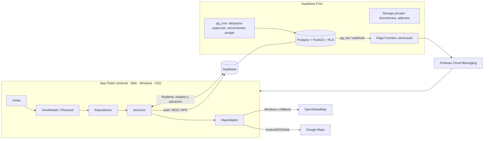
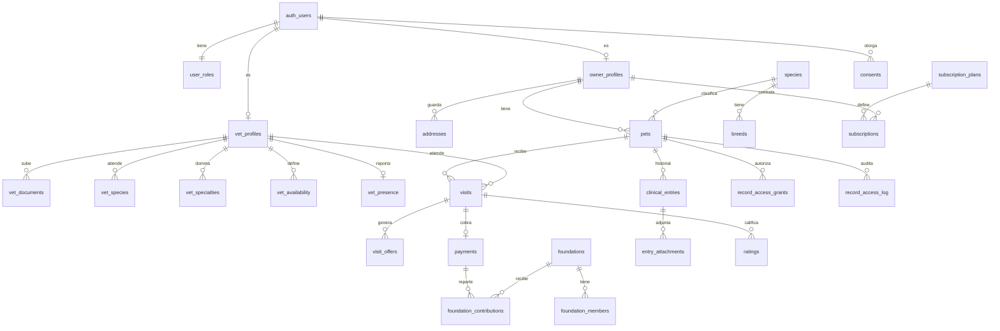
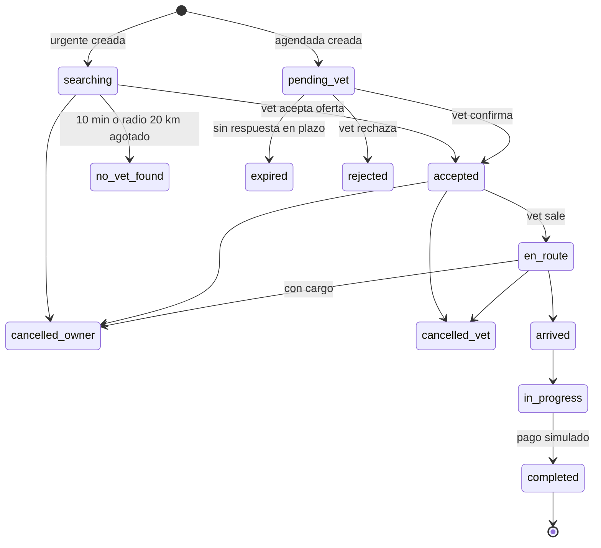

# Arquitectura — Proyecto Felix (v1)

> Estado: borrador v1 para aprobación · Fecha: 2026-11-16 · Requisitos: [SPEC.md](../SPEC.md)

## 1. Stack elegido y por qué

| Capa | Elección | Por qué |
|---|---|---|
| App | **Flutter 3.47** (Android, Web, Windows, iOS) | Un solo código para las 4 plataformas pedidas. |
| Estado | **Riverpod** | Se testea sin `BuildContext`, maneja bien streams (Realtime) y permite sobrescribir dependencias en los tests. |
| Rutas | **go_router** | Rutas declarativas, deep links y URLs limpias en Web, y protección de rutas por rol. |
| Modelos | **freezed + json_serializable** | Modelos inmutables, igualdad por valor y `copyWith`. |
| Backend | **Supabase (nivel gratuito)**: Postgres 17, Auth, Storage, Realtime, Edge Functions y Cron | Ver la comparación en §2. |
| Geo | **PostGIS** (`geography(Point)`, `ST_DWithin` y un índice GiST) | Matching por cercanía dentro de la base de datos. |
| Mapas | **Google Maps** como principal y **OpenStreetMap** (`flutter_map`) como alternativa, detrás de `MapAdapter` | `google_maps_flutter` **no soporta Windows**, así que en Windows el adaptador usa OSM. |
| Push | **Firebase Cloud Messaging** (gratuito), solo para notificaciones | Android, iOS y Web. Windows no tiene FCM y usa avisos dentro de la app vía Realtime. |
| CI | **GitHub Actions** (gratis en repos públicos; 2.000 min/mes en privados) | Corre `analyze`, `test` y pgTAP en cada push. |
| Tests | `flutter_test`, `integration_test`, **pgTAP** (`supabase test db`) | La seguridad (RLS) y las reglas de negocio se prueban en la base de datos. |

Paquetes principales (las versiones se fijan en `pubspec.lock` en la fase 0): `supabase_flutter`, `flutter_riverpod`, `go_router`, `freezed`, `json_serializable`, `google_maps_flutter`, `flutter_map`, `latlong2`, `geolocator`, `firebase_messaging`, `file_picker`, `image` (compresión).

> **`supabase_flutter` v3** salió el 2026-11-06 con cambios incompatibles con v2. En la fase 0 se decide la versión: v3 si su API ya está estable en pub.dev; si no, v2.x fijada.

## 2. Backend: ¿por qué Supabase?

| Criterio | **Supabase (Free)** | Firebase (Spark) | Local (Postgres o PocketBase en tu PC) |
|---|---|---|---|
| Seguridad de la ficha clínica | **RLS en SQL**: reglas por fila, auditables y testeables con pgTAP. Incluye joins y vencimientos de acceso | Security Rules: posibles, pero las consultas relacionales (acceso por visita y vencimiento) son incómodas y se testean con un emulador | Total control, pero toda la autorización se programa a mano |
| Cercanía en tiempo real | **PostGIS** + Realtime (Postgres Changes y Broadcast privado) | Geohash manual en Firestore; las consultas por radio son aproximadas | PostGIS posible; el tiempo real habría que montarlo |
| Lógica en servidor | Funciones SQL, **pg_cron** y Edge Functions (500.000 invocaciones/mes) incluidos | **Cloud Functions requiere el plan Blaze (con tarjeta)** | Sí, pero sin hosting público |
| Límites gratuitos | 500 MB de BD, 1 GB de archivos, 5 GB de egress, 50.000 MAU, 200 conexiones Realtime, 2 M de mensajes/mes, **se pausa tras 1 semana sin uso** | Generosos en lecturas y escrituras, pero sin funciones de servidor | Sin límites, pero no es accesible desde celulares fuera de tu red |
| Modelo de datos | Relacional: encaja con visitas, pagos, fichas y fundaciones | Documental: totales y joins más difíciles | Relacional |

**Decisión: Supabase confirmado.** Es la única opción gratuita con autorización por fila en SQL, geoconsultas reales y jobs programados sin tarjeta. Desarrollamos contra Supabase **local** (CLI + Docker) y desplegamos al proyecto gratuito en la nube.

Cambios recientes de Supabase que afectan el diseño (changelog 2026):

- Las tablas nuevas de `public` **ya no se exponen** a la Data API por defecto: cada migración incluye `grant` explícitos además de la RLS.
- El esquema `realtime` está bloqueado. Para la autorización de canales privados se usan políticas sobre `realtime.messages`.
- Los proyectos Free nuevos con el SMTP por defecto no pueden personalizar los correos de Auth. Se acepta el correo estándar (o un SMTP gratuito más adelante).

## 3. Diagrama general



### Capas en Flutter (skill `flutter-apply-architecture-best-practices`)

```text
lib/
├── core/            # config (env), router, theme, errores, Result
├── data/
│   ├── services/    # SupabaseService, StorageService, PushService, GeoService
│   ├── maps/        # MapAdapter (interfaz) + GoogleMapAdapter + OsmMapAdapter
│   └── repositories/# AuthRepo, PetRepo, VisitRepo, RecordRepo, PaymentRepo, CatalogRepo...
├── domain/
│   ├── models/      # freezed: Pet, Visit, ClinicalEntry, Quote, Plan...
│   └── use_cases/   # solo donde haya lógica cruzada (p. ej. RequestUrgentVisit)
└── ui/
    ├── core/        # widgets compartidos
    └── features/{auth,owner,vet,admin,foundation,record,visit}/{views,view_models}
```

Se adapta la guía oficial cambiando `ChangeNotifier` por Notifiers de Riverpod. Los repositorios exponen modelos de dominio y la UI nunca llama a Supabase directamente.

**`MapAdapter`**: interfaz con `buildMap(center, markers, polylines, onTap)`, `animateTo` y `geocode`/`reverseGeocode` (detrás de `GeocodingAdapter`). Se elige con `MAP_PROVIDER=google|osm` en el entorno y por plataforma: en Windows siempre OSM. Un test de contrato corre la misma suite sobre ambas implementaciones.

Implementación (fase 4, `lib/data/maps/`):

- `MapAdapter.buildMap(...)` + `MapViewController.animateTo`. `GoogleMapAdapter` (Android y Web; en Web el SDK JS se inyecta en tiempo de ejecución con la clave de `--dart-define`, y en Android la clave llega al manifiesto desde los dart-defines) y `OsmMapAdapter` (`flutter_map`, URL de tiles configurable con `OSM_TILE_URL`; en producción Stadia o MapTiler).
- iOS usa OSM hasta probar en un Mac la clave nativa (`GMSServices.provideAPIKey`).
- `GeocodingAdapter.search/reverse`: `GoogleGeocodingAdapter` (REST, solo Android) y `NominatimGeocodingAdapter` (Web siempre, porque la API REST de Google no admite CORS). Ambos van detrás de `CachingGeocodingAdapter` (LRU de 100 entradas + deduplicación). Nominatim además usa una cola con 1,1 s entre peticiones y un User-Agent genérico de la app (en Web, el navegador manda el Referer). La UI aplica debounce de 700 ms a la búsqueda y de 900 ms a la geocodificación inversa.
- Tests de contrato sin red: `MockClient` para el geocoding, un `TileProvider` offline para OSM y una `GoogleMapsFlutterPlatform` falsa para Google.

**Mascotas y direcciones (fase 4):**

- `pets` y `addresses`: solo el dueño lee y escribe (rol `owner`). El admin no las ve (minimización), y el vet tampoco: la ficha llega en la fase 7 vía `get_pet_record` y la dirección del vet asignado, en la fase 6.
- Sin DELETE: se desactivan (`active`). Topes de 20 mascotas y 10 direcciones activas por dueño (con advisory lock).
- `private.guard_pet` valida que la especie esté activa y que la raza pertenezca a la especie (solo al crear o al cambiarlas: desactivar una especie no bloquea las mascotas existentes) y que la fecha de nacimiento no sea futura.
- `addresses.location geography(Point)` es columna **generada** desde `lat`/`lng` y tiene un índice GiST.
- **Coherencia entre punto y comuna (QA-F4-01/02):**
  - `public.commune_boundaries` guarda los límites simplificados de 345 comunas, con licencia CC BY 3.0 IGO. Vienen de geoBoundaries `gbOpen CHL ADM3`, versión `9469f09`, de origen BCN y OCHA ROLAC. La fuente, el SHA-256 y el procesamiento se citan en la migración `commune_boundaries`.
  - `private.guard_address` exige que el punto esté a 2,5 km o menos del límite de la comuna elegida. El error máximo medido de la simplificación es de 2,09 km. Fuera de toda comuna, el mensaje es "La ubicación debe estar en Chile".
  - Antártica no tiene polígono en la fuente. Para ella se acepta el Territorio Chileno Antártico (Decreto 1747 de 1940, entre 53° y 90° O), al sur de 60° S.
  - La RPC `communes_at_point` (SECURITY INVOKER) ordena las comunas compatibles por profundidad dentro del límite. La UI propone con ella la comuna del punto marcado y solo ofrece las compatibles.
  - El centro de cada comuna (`ST_PointOnSurface`) centra el mapa sin consultar al geocoder.
  - Límite conocido: en zonas urbanas, a menos de 2,5 km de un borde también se acepta la comuna vecina.
- **Geocoding de Google:** se usa solo en Android y solo con `GOOGLE_GEOCODING_API_KEY`, una clave propia restringida por API y con cuota. La clave del mapa, restringida a la app, no sirve: la API REST la rechaza sin las cabeceras `X-Android-Package` y `X-Android-Cert`. Por defecto se usa Nominatim.
- `private.address_approx(address, from)` devuelve la comuna y la distancia redondeada a 0,5 km para las ofertas de la fase 6. No tiene EXECUTE para la app.

**Precios, pagos simulados y fundaciones (fase 5):**

- **Cotización:** `quote_visit(pet, address, specialty, mode, vet?, foundation?, extra_donation)` no recibe montos. Valida dueño, mascota, dirección, especie↔especialidad (`species_specialties`) y vet (aprobado, con la especie y la especialidad), y guarda una fila **inmutable** en `quotes` (vigencia de 30 min, tope de 60 por dueño y hora) con la versión de `pricing_config` usada. Devuelve el snapshot JSON (`private.quote_snapshot`), que es lo que la fase 6 guardará en `visits.quote`.
- **Contrato con la fase 6:** `private.consume_quote(quote_id, owner)` bloquea la cotización (`for update`), verifica dueño, vigencia y que no esté usada, y la marca `consumed_at`. `private.quote_for(..., p_origin)` es el núcleo reutilizable (por ejemplo, para recotizar una urgencia con la presencia del vet en la fase 8). Ninguno de los dos tiene EXECUTE para la app.
- **Distancia (QA-F5-01/02):** `ST_Distance(addresses.location, vet_bases.quote_origin)` en metros. `vet_bases` es el punto de partida del vet (solo lo lee el propio vet; se valida contra `commune_boundaries` como las direcciones; la UI llega con la agenda). `quote_origin` es la base desplazada **1–2 km con rumbo aleatorio, fijado al crear la base** (`fuzz_dlat`/`fuzz_dlng`, sin grant de escritura): redondear no basta, porque moviendo su dirección y mirando dónde cambia el valor redondeado o los km facturables un dueño recupera la distancia exacta con pocas cotizaciones (tope 60/h). Así lo máximo trilaterable es el punto falso y la base real queda en un anillo de 1–2 km (~9,4 km²); el costo es ±2 km de recargo (±$1.000). `quotes.distance_m` no es legible por la API (grant por columna) y el cliente recibe `distance_km` al km. Tope `pricing_config.max_distance_km` (30 km por defecto: cruza el Gran Santiago, recargo máximo ~$12.500); sobre eso, la cotización se rechaza. Sin vet (urgencia antes de aceptar), la distancia queda pendiente y el recargo es 0.
- **Fórmula y redondeo** (`private.price_breakdown`, pura): urgencia = `clp_round(base × urgent_pct)`; km facturables = `ceil((m − free_km·1000)/1000)` (mínimo 0); descuento = `clp_round(base × discount_pct)` o la base completa si es preventiva incluida; servicio = base − descuento + urgencia + km × per_km; comisión = `clp_round(servicio × commission_pct)`; fundación = `clp_round(comisión × foundation_pct)`; **vet = servicio − comisión** (cuadra al peso); total = servicio + donación. `clp_round` = mitad hacia arriba. Los parámetros de suscripción ya existen en la función (fase 10 los alimenta).
- **Pagos:** `payments.provider` solo admite `simulated`; estados `pending → simulated_paid | simulated_failed`. Montos inmutables (trigger, incluso para SQL interno) y con `check` de cuadratura. `payment_events` guarda cada cambio de estado y, al pagarse, un trigger crea `foundation_contributions` (`commission_share`, `donation`). `simulate_payment(quote_id, simulate_failure)` es la única vía de pago; un fallo no consume la cotización (máx. 5 intentos).
- **Fundaciones:** `foundations` (una sola `is_default`, que debe estar activa; `set_default_foundation` es atómica y solo admin), `foundation_members` (rol `foundation`, los crea el admin por SQL) y `owner_profiles.foundation_id` (elección del dueño; si es null o queda inactiva, se usa la por defecto). Los miembros **no** leen `payments` ni `foundation_contributions`: solo `foundation_summary()` (totales por mes, zona `America/Santiago`).
- **RLS:** el dueño ve sus cotizaciones y pagos; el admin, todo; vets y fundaciones, nada de pagos (SPEC HU8.6).
- **Precio de lanzamiento:** consulta general a domicilio $26.990 todo incluido hasta 5 km (10 % bajo los $30.000 habituales), migración `20261117210000_general_tariff_26990`: comisión $4.049, fundación $810, vet $22.941. Preparado sin activar: `pricing_config.commission_on_distance` (`false` = el recargo por km va 100 % al vet). El incentivo de $500 por transferencia sigue sin definirse.

## 4. Modelo de datos

Convenciones: `uuid` como PK en tablas expuestas (evita IDs predecibles), `bigint identity` en logs internos, `timestamptz`, montos en **CLP `integer`**, `text` con `check` para estados, índice en toda FK y en toda columna usada por RLS. RLS habilitada y forzada en **todas** las tablas.



### Entidades

| Grupo | Tabla | Campos clave |
|---|---|---|
| Identidad | `user_roles` | `user_id` PK, `role` (`owner`,`vet`,`foundation`,`admin`). Solo la escribe el admin o el trigger de registro. |
| | `owner_profiles` | `user_id`, `display_name`, `phone` (visible solo para el vet asignado durante la visita), `commune_id`. **Sin RUT.** |
| | `terms_acceptances`, `privacy_notice_views` | `user_id`, `version`, `at` (contrato y deber de información; no son consentimiento) |
| | `consents` | `user_id`, `purpose` (solo opcionales: `marketing`, ...), `version`, `granted_at`, `revoked_at` |
| | `deletion_requests` | `user_id`, `requested_at`, `execute_after` (+15 d), `status` (`blocked`,`executing`,`done`,`cancelled`) |
| | `deletion_targets` | `request_id`, `system` (`db`,`storage`,`fcm`,`logs`), `action`, `ack_at`, `verified_at`, `retained_reason` |
| | `security_incidents` | registro de brechas: `detected_at`, `severity`, `affected`, `notified_agency_at`, `notified_subjects_at` |
| Ubicación | `regions`, `communes` | catálogo nacional |
| | `addresses` | `owner_id`, `label`, `street_text`, `commune_id`, `location geography(Point)` |
| Mascotas | `species`, `breeds`, `specialties`, `species_specialties` | catálogos con `active` |
| | `pets` | `owner_id`, `name`, `species_id`, `breed_id`, `sex`, `birth_date_approx`, `microchip` (opcional) |
| Veterinarios | `vet_profiles` | `user_id`, `display_name`, `status` (`pending`,`approved`,`rejected`,`suspended`), `identity_verified_at`, `verified_by`, `rating_avg`, `cancel_count_30d`. **Sin RUT en el MVP** (si llegan pagos reales: `private.vet_identity`, solo admin). |
| | `vet_documents` | `vet_id`, `kind` (`degree`,`id_card`), `storage_path` (se anula al purgar), `review_status`, `reviewed_by`, `reviewed_at`, `purge_after` |
| | `vet_species`, `vet_specialties` | tablas puente |
| | `vet_availability`, `vet_time_off` | bloques semanales (`weekday`, `start_time`, `end_time`) y rangos `tstzrange` |
| | `vet_presence` | `vet_id`, `online`, `location geography`, `updated_at`. **No es legible por la API**: solo la usan funciones internas. |
| Visitas | `visits` | `owner_id` (nullable, para anonimizar), `pet_id` (nullable), `vet_id`, `mode` (`urgent`,`scheduled`), `status`, `address_id` (nullable), `commune_id`, `species_id`, `specialty_id`, `slot tstzrange`, `search_radius_km`, `search_started_at`, `quote jsonb` (congelado), `foundation_id`, `cancel_reason`, `is_preventive` |
| | `visit_offers` | `visit_id`, `vet_id`, `batch_no`, `radius_km`, `distance_km_rounded`, `expires_at`, `response` (`pending`,`accepted`,`rejected`,`expired`,`void`) |
| Pagos | `pricing_config` | versión con `effective_from`: `commission_pct`, `foundation_pct`, `urgent_pct`, `per_km`, `free_km`, `cancel_fee` |
| | `tariffs` | `species_id`, `specialty_id`, `base_price` |
| | `payments` | `visit_id`, `kind` (`visit`,`cancel_fee`,`subscription`), `service_price`, `platform_fee`, `foundation_share`, `vet_payout`, `extra_donation`, `total`, `status` (siempre `simulated_paid`) |
| | `foundations`, `foundation_members`, `foundation_contributions` | aportes: `payment_id`, `foundation_id`, `kind`, `amount`, `created_at` |
| Suscripciones | `subscription_plans`, `subscriptions`, `subscription_pets` | `discount_pct`, `preventive_per_year`, `waive_urgent`, `max_pets`, `price_monthly`; uso del cupo calculado desde `visits.is_preventive` |
| Ficha | `clinical_entries` | `pet_id`, `visit_id`, `author_id`, `author_role` (`vet`,`owner`), `kind` (`consultation`,`vaccine`,`diagnosis`,`note`), `specialty_id`, `species_id` (snapshot), `body jsonb`, `vaccine_next_due`, `supersedes_id`, `created_at`, `retain_until` (solo en entradas desvinculadas tras un borrado). **Solo inserción** (la desvinculación la hace únicamente el job de borrado). |
| | `entry_attachments` | `entry_id`, `storage_path`, `mime`, `size_bytes` |
| | `record_access_grants` | `pet_id`, `vet_id`, `source` (`visit`,`owner`), `visit_id`, `starts_at`, `expires_at` (null = mientras la visita esté activa), `revoked_at` |
| | `record_access_log` | `bigint`, `pet_id`, `entry_id`, `actor_id`, `action` (`view`,`create`,`correct`,`export`,`grant`,`revoke`), `at`. Solo inserción y sin datos clínicos. |
| Otros | `ratings` | `visit_id`, `rater_id`, `ratee_id`, `stars`, `comment`, `hidden`, `published_at` |
| | `device_tokens` | `user_id`, `token`, `platform` |
| | `emergency_clinics` | catálogo admin: nombre, comuna, teléfono, 24 h |
| | `admin_audit_log` | acciones del admin |

Restricciones destacadas:

- **Sin doble reserva:** `exclude using gist (vet_id with =, slot with &&) where status in (activos)` (requiere `btree_gist`). El `slot` incluye el margen de traslado.
- **Aceptación de urgencia:** la RPC `accept_offer(offer_id)` hace `select ... for update` sobre la visita, verifica `status = 'searching'` y la oferta `pending` y no vencida, asigna el vet y anula las demás ofertas. Es atómica, así que en caso de empate gana el primero.

## 5. Máquina de estados de la visita



Las transiciones se validan en la función `private.transition_visit(visit_id, to_status)`, que verifica el rol del actor y que el cambio sea un borde permitido. El cliente nunca hace `update` directo sobre `status`.

**Fase 6 (implementado):** se suma el borde `pending_vet → cancelled_owner` (el dueño retira una solicitud sin costo). El vet asignado confirma, rechaza, sale (desde 2 h antes), llega, inicia, completa o cancela; el dueño solo cancela (cargo según `private.cancel_fee_for`); el sistema expira (`pending_vet → expired` al vencer `confirm_deadline = min(creación + 12 h, hora − 2 h)`) y cierra como `cancelled_vet`, sin cargo, una visita `accepted` que no pasó a "en camino" 1 h después de su hora. Cada cambio queda en `visit_events`. El pago simulado ocurre después de `completed` (`simulate_payment(visit_id)`).

**Correcciones de QA fase 6 (`20261118124201_qa_f6_fixes.sql`, constantes en `private.visit_timing()`):**
- "Llegó" e "inicia" solo desde **30 min antes** de la hora; "completada" con al menos **10 min** de atención (`visits.started_at`).
- Una visita `en_route` o `arrived` que sigue así **2 h después** de la hora se cierra sola como `cancelled_vet`, sin cargo. Nuevo borde `arrived → cancelled_vet` (el vet o el sistema).
- Si el vet va "en camino" y ya pasaron **30 min** de la hora, el dueño cancela **sin cargo**.
- Sin punto de partida (`vet_bases`) no hay cotización con ese vet ni reserva (la cotización debe tener distancia).
- `available_vets` preselecciona por KNN los 30 vets compatibles más cercanos a `quote_origin`, calcula sus horarios en una consulta por vet y devuelve hasta 20; tope de **30 búsquedas por dueño y minuto** (`private.search_quota`).
- El admin no lee `visit_events` (solo `admin_visit_summary`).
- **Seguimiento (`20261118181914_qa_f6_followup.sql`).** QA-F6-07: los vets con un día libre que cubre todo el día pedido no son candidatos, y los candidatos se ordenan por distancia (KNN) y se recorren en bloques de 40 (horarios en una consulta por bloque) hasta reunir 20 con horario libre o agotar el radio; ya no hay un tope fijo de 30 candidatos. Peor caso medido (300 vets sin horario + 300 con día libre + 5.000 visitas): 67–95 ms. QA-F6-06: una visita `in_progress` se cierra sola como **`completed`** (actor nulo = sistema) a las **6 h del inicio o 8 h de la hora agendada**, lo primero (`private.visit_progress_limits()`). Se eligió `completed` porque la atención sí empezó; no hay cobro automático: el dueño paga (simulado) desde la app. La dirección exacta y el teléfono dejan de entregarse apenas vence la ventana activa de cada estado (`private.visit_active_until`), aunque el cron todavía no la cierre.
- `scheduled_at`, `slot`, `confirm_deadline` y `started_at` son inmutables. Solo una sesión directa de `postgres` con `felix.time_travel = 'on'` los mueve (pgTAP y E2E vía `tool/e2e/sql.mjs`); la API conecta como `authenticator` y no puede.

## 6. Despacho de urgencias

1. El dueño llama a `request_urgent_visit(pet_id, address_id, specialty_id, foundation_id, extra_donation)`. Esta función valida que la mascota y la dirección sean suyas, cotiza con `quote_visit` y crea la visita en estado `searching`.
2. **pg_cron cada 10 s** ejecuta `private.dispatch_urgent_visits()`, que para cada visita en búsqueda:
   - vence las ofertas pendientes con `expires_at < now()`;
   - si no quedan ofertas pendientes, busca hasta 3 candidatos: `vet_presence.online`, `updated_at > now() - 2 min`, `ST_DWithin(location, destino, radio)`, especie y especialidad compatibles, sin visita activa y sin una oferta previa para esta visita. Los ordena por distancia y luego por `rating_avg`;
   - si hay candidatos, crea las ofertas con 60 s de vigencia. Si no hay, sube el radio (5 → 10 → 20). Si ya está en 20 km o pasaron 10 min, cambia la visita a `no_vet_found`.
   - Usa `for update skip locked` sobre las visitas para que dos ejecuciones no compitan.
3. Al insertar ofertas, un trigger llama por `pg_net` a la Edge Function `send-push`, que envía el push por FCM. **El payload lleva solo `visit_id` + tipo de evento**; la app trae el detalle por la API. Las Edge Functions no registran payloads en logs.
4. **Ubicación en vivo:** el vet envía su posición cada 5 s por un **canal privado de Realtime Broadcast** `visit:{id}`, autorizado con RLS en `realtime.messages` solo para el dueño y el vet de esa visita, y solo en estado `en_route`. No se guarda el recorrido. Además, `vet_presence` se actualiza cada 30 s mientras el vet está en línea, y solo se usa para el matching.

**Presupuesto Realtime:** 200 conexiones simultáneas y 2 M de mensajes al mes. Un trayecto de 20 min con posición cada 5 s son unos 240 mensajes. Alcanza para una demo de sobra.

## 7. Políticas RLS de la ficha clínica

Los helpers viven en el esquema **`private`** (no expuesto), con `security definer`, `set search_path = ''` y `revoke execute ... from public`. Siempre usan `(select auth.uid())`.

```sql
-- ¿El usuario es dueño de la mascota?
create function private.is_pet_owner(p_pet uuid) returns boolean
language sql stable security definer set search_path = '' as $$
  select exists (select 1 from public.pets
                 where id = p_pet and owner_id = (select auth.uid()));
$$;

-- ¿El vet tiene acceso vigente? (visita activa, ventana de 30 días o autorización del dueño)
create function private.vet_has_record_access(p_pet uuid) returns boolean
language sql stable security definer set search_path = '' as $$
  select exists (
    select 1 from public.record_access_grants g
    join public.vet_profiles v on v.user_id = g.vet_id and v.status = 'approved'
    where g.pet_id = p_pet
      and g.vet_id = (select auth.uid())
      and g.revoked_at is null
      and g.starts_at <= now()
      and (g.expires_at is null or g.expires_at > now())
  );
$$;
```

```sql
alter table public.clinical_entries enable row level security;
alter table public.clinical_entries force row level security;

-- LECTURA DIRECTA: solo el dueño. El vet lee exclusivamente vía get_pet_record (registra cada lectura).
-- Sin lectura para el admin (minimización).
create policy ce_select_owner on public.clinical_entries for select to authenticated
using ( (select private.is_pet_owner(pet_id)) );

-- ESCRITURA VET: con acceso vigente, como autor de sí mismo y con tipos clínicos.
create policy ce_insert_vet on public.clinical_entries for insert to authenticated
with check ( author_id = (select auth.uid()) and author_role = 'vet'
             and (select private.vet_has_record_access(pet_id)) );

-- ESCRITURA DUEÑO: solo notas.
create policy ce_insert_owner on public.clinical_entries for insert to authenticated
with check ( author_id = (select auth.uid()) and author_role = 'owner' and kind = 'note'
             and (select private.is_pet_owner(pet_id)) );

-- Sin políticas UPDATE ni DELETE: la ficha es inmutable. Además:
revoke update, delete on public.clinical_entries from anon, authenticated;
```

- **`record_access_grants`:** el dueño lee las de sus mascotas, inserta las de `source = 'owner'` (con `expires_at` obligatorio) y solo hace update de `revoked_at`, con `using` y `with check`. Las de `source = 'visit'` las crean y cierran triggers de la visita: al aceptar, `expires_at = null`; al terminar, `completed_at + 30 d`. El vet lee solo las suyas.
- **`record_access_log`:** insert solo vía triggers y funciones. El dueño lee el log de sus mascotas, el admin lo lee para auditoría y nadie hace update ni delete.
- **Registro de lecturas:** Postgres no tiene triggers de `SELECT`, así que la app lee la ficha por la RPC `public.get_pet_record(p_pet)`. Esta función verifica `is_pet_owner or vet_has_record_access`, inserta en el log (actor = `auth.uid()`) y devuelve las entradas y los adjuntos. Si no hay acceso, lanza un error sin revelar si la mascota existe. Como el vet **no tiene `SELECT` directo** (solo `ce_select_owner`), no puede saltarse el log. La RPC es `security definer` con `set search_path = ''`, verificación explícita de `auth.uid()` y `execute` concedido solo a `authenticated`. Es la única excepción justificada a `security invoker` y tiene sus propios tests pgTAP. Las mismas reglas aplican a `entry_attachments`.
- **Storage `clinical-attachments`:** bucket privado con rutas `pets/{pet_id}/{entry_id}/{archivo}`. Las políticas sobre `storage.objects` reutilizan los mismos helpers, y la descarga es por URL firmada de 60 s.
- **Admin:** no lee el contenido clínico. Solo ve metadatos (conteos) y el log de auditoría.

Matriz pgTAP obligatoria (fase 7): {dueño, otro dueño, vet con visita activa, vet a los 29 días, vet a los 31 días, vet con acceso revocado, vet autorizado por el dueño, vet suspendido, admin, anónimo} × {leer, insertar nota, insertar diagnóstico, actualizar, borrar, leer el log, descargar un adjunto}.

## 8. Privacidad (Ley 21.719, vigente desde el 1 de diciembre de 2026)

Revisado por el agente Privacy Engineer (2026-11-16). El detalle va en `docs/privacidad.md` (fase 12).

- **Titulares:** dueños, vets y miembros de fundaciones. Los tres tienen derechos de acceso, rectificación, supresión, oposición, portabilidad y bloqueo.
- **Minimización:** sin RUT (ni dueño ni vet). La dirección exacta y el teléfono del dueño solo los ve el vet asignado durante la visita. No se guarda el recorrido GPS y `vet_presence` se sobrescribe sin historial. La dirección se geocodifica **una sola vez** al guardarla. El microchip solo lo ven el dueño y un vet con acceso. El plan y los pagos del dueño nunca se muestran a vets ni fundaciones.
- **Bases de licitud:** contrato para el servicio, incluida la ubicación del vet en línea o en camino (con aviso visible "compartiendo ubicación"). Consentimiento solo para lo opcional. La política de privacidad se registra como información entregada, no como consentimiento.
- **Borrado:** solicitud → bloqueo inmediato y revocación de sesiones → gracia de 15 días → las entradas clínicas de vets se desvinculan y se retienen 5 años (`retain_until`, acceso solo del vet autor por solicitud registrada); lo demás se borra → job sobre `deletion_targets` → escaneo de verificación → registro de lo borrado y lo retenido. Las entradas clínicas de un vet que se da de baja quedan con el autor seudonimizado.
- **Retención:** documentos de vets por 7 días tras aprobarse (30 si se rechaza, ventana de apelación); los de solicitudes nunca enviadas, 90 días; los archivos subidos sin registrar, 24 horas · acceso vía visita por 30 días · `record_access_log` por 2 años y luego se anonimiza el actor · tokens de dispositivos sin uso en 90 días se borran.
- **Transferencias internacionales:** Supabase en la región **sa-east-1 (São Paulo)**, Google (Auth, Maps, Geocoding, FCM) y OSM/Nominatim (solo con datos semilla) quedan todos fuera de Chile. Se documentan en un inventario de encargados (país, datos, mecanismo, DPA) y se informan en la política.
- **Decisiones automatizadas:** el orden del despacho (distancia y calificación) se documenta para los vets. Toda suspensión la decide un admin humano y el vet puede pedir revisión.
- **Seguridad:** RLS forzada, buckets privados, URLs firmadas cortas, JWT corto (1 h), escaneo periódico de PII en campos de texto libre y logs, `security_incidents` y un runbook de brechas.
- **Datos de prueba:** solo semillas ficticias marcadas con `is_seed`. Nunca datos reales en dev, en el notebook ni en el repo.

### 8.1 Verificación de veterinarios (fase 3)

En Chile **no existe un registro público oficial de veterinarios**: el Registro Nacional de Prestadores Individuales de la Superintendencia de Salud cubre profesiones de salud humana, y la colegiatura en COLMEVET es voluntaria. Por eso la verificación combina evidencias y una revisión humana:

1. **Certificado de título** de una universidad reconocida por el Estado (o un título extranjero revalidado), con su código o folio de verificación si lo trae.
2. **Cédula de identidad (anverso)** para confirmar que el nombre coincide. No se guarda el RUT.
3. **COLMEVET** (opcional) como evidencia adicional.
4. **Declaración jurada simple** (`declaration_accepted_at`).
5. **Revisión del admin** con lista de chequeo: el nombre coincide, la universidad está reconocida, el certificado fue verificado con la universidad y, opcionalmente, COLMEVET. El resultado queda en `review_notes`, `verified_by` y `admin_audit_log`.

Implementación:

- Bucket privado `vet-documents` (PDF, JPG o PNG de hasta 5 MB, con carpeta = id del vet).
- `private.guard_vet_profile` impide que el vet toque los campos de la revisión o su estado, bloquea los datos profesionales en revisión o tras la aprobación y valida los requisitos al enviar.
- RPC `submit_vet_application` y `review_vet_application`. Rechazar exige un motivo, y el vet puede reenviar.
- Retención: cada documento nace con `purge_after = now() + 90 días` (borrador). La revisión lo reemplaza por 7 días si se aprueba o 30 si se rechaza. El vet no puede fijar `purge_after`, `review_status` ni `purged_at`: el INSERT tiene privilegio por columna, y forjarlos da 403.
- Purga: la Edge Function `purge-vet-documents` borra con la API de Storage (no por SQL) los documentos vencidos, usando la RPC `purge_candidates` (solo `service_role`), y deja solo los metadatos. **Omite las solicitudes en revisión**, para no borrar evidencia antes de que el admin decida.
- Huérfanos: un archivo subido cuyo registro en `vet_documents` falló se borra pasadas 24 horas (RPC `purge_orphan_candidates`, solo `service_role`). El vet nunca puede borrar archivos del bucket.
- pg_cron invoca la purga cada hora si existen en Vault los secretos `project_url` y `service_role_key`.

**Verificación asistida** (análisis completo en `docs/verificacion-automatica.md`). Ninguna fuente oficial confirma un título por máquina sin pedir el RUT, así que la automatización **sugiere** y el admin decide. No hay auto‑aprobación.

- **Edge Function `verify-vet-title`**:
  - El admin la invoca para cualquier solicitud en revisión; el vet, solo para la suya. La app la dispara en segundo plano al enviar la solicitud, y el admin puede volver a ejecutarla desde la revisión.
  - Usa proveedores detrás de la interfaz `TitleVerificationProvider`:
    - `RulesProvider` (siempre): universidad en la lista inicial (debe validarla el usuario), año plausible, código presente y título extranjero → riesgo.
    - `ColmevetProvider`: búsqueda por nombre en el buscador público. La colegiatura es voluntaria: "sin coincidencias" es neutro.
    - `FakeProvider`: para tests y E2E.
  - Configuración: `TITLE_VERIFICATION_PROVIDER` = `off` (por defecto) | `fake` | `colmevet`. Timeout de 8 s, tope de 1 MB y User-Agent propio. Nunca salta captchas.
- **Tabla `vet_title_verifications`**:
  - Solo inserción vía `service_role`. El vet lee las suyas y el admin todas; nadie las borra.
  - Los proveedores solo pueden sugerir `university` y `colmevet`: `name` y `code` los confirma siempre una persona.
  - Evidencia mínima, sin nombres ni datos de terceros.
- **Cuota** `reserve_title_verification` (solo `service_role`): reserva **atómica** con advisory lock (QA-19), con cupos separados (QA-20): vet 3 ejecuciones cada 10 min, admin 10 por solicitud cada 10 min, y 20 consultas a COLMEVET por minuto en total.
- **Revisión del admin**: muestra la fuente, el resultado, el riesgo y la fecha de la ronda actual. Precompleta los chequeos sugeridos (se pueden desmarcar) y agrega una línea de resumen a `review_notes`. Si la verificación falla o está apagada, el flujo manual no cambia.
- **Pendiente de decisión del usuario**:
  - Activar COLMEVET (pedir antes autorización y actualizar la política de privacidad).
  - No pedir RUT.
  - Exigir el "Certificado de profesionales" del Registro Civil, que el admin verifica con folio + código.

## 9. Secretos y configuración

- **Cliente (`.env`, en `.gitignore`):** se carga con `flutter run --dart-define-from-file=.env`. Contiene `SUPABASE_URL`, `SUPABASE_PUBLISHABLE_KEY`, `MAPS_API_KEY` y `MAP_PROVIDER`. Estas claves quedan dentro de la app (no son secretas en sentido estricto), así que se protegen con **restricciones**: RLS en Supabase y restricción por app o dominio en Google Cloud. Se versiona la plantilla `env.example` sin valores (sin punto inicial: la regla de permisos de Claude Code bloquea `.env.*`).
- **Servidor:** la clave `service_role`/secreta, la cuenta de servicio de FCM y el token de acceso de Supabase **nunca** van en el código ni en el cliente. Van en los secretos de Supabase (`supabase secrets set`) y en `supabase/.env` local (en `.gitignore`).
- La lectura de `.env` ya está bloqueada para Claude Code en `.claude/settings.json`.
- **Nube (Beta):** Supabase **Pro** (el plan Free se pausa y no tiene respaldos) en sa-east-1 con cómputo Micro, y Flutter Web en Cloudflare Pages. Pasos, secretos de GitHub (Environments `beta`, `production` y `backup`) y rollback en `docs/despliegue-beta.md`. Capacidad medida en `docs/qa/capacidad-5000.md`.

## 10. Riesgos principales

| Riesgo | Impacto | Mitigación |
|---|---|---|
| **Una RLS mal escrita expone fichas clínicas** | Alto | Matriz pgTAP obligatoria, `supabase db advisors` en CI, revisión del Privacy Engineer y `/security-review` antes de cada release. |
| **Google Maps exige una cuenta de facturación (tarjeta)**, aunque el uso esté dentro de la cuota gratuita | Medio | Adaptador: si no se habilita la facturación, se usa `MAP_PROVIDER=osm` en todas las plataformas. Alertas de presupuesto en $0 en Google Cloud. |
| Política de uso de los tiles de OSM (no apta para tráfico alto) y de Nominatim (1 req/s) | Bajo (demo) | User-Agent propio y caché. Si crece, cambiar a un proveedor de tiles con nivel gratuito sin tocar el resto. |
| El proyecto Free **se pausa tras 7 días sin uso** | Medio | Documentar cómo reactivarlo. Opcional: un ping semanal desde GitHub Actions. |
| **Docker y la Supabase CLI no están instalados** (requisito para pgTAP local) | Medio | Fase 0: instalar Docker Desktop (gratis para uso personal) y Supabase CLI. Alternativa: un segundo proyecto Free como entorno de pruebas. |
| `supabase_flutter` v3 es muy reciente (con cambios incompatibles) | Bajo | Decidir y fijar la versión en la fase 0. |
| Storage de 1 GB | Bajo | Límite de 5 MB por archivo, compresión de imágenes y purga de documentos de vets. |
| No hay FCM en Windows | Bajo | Avisos dentro de la app por Realtime. Documentado. |
| iOS sin Mac | Bajo | El código usa paquetes compatibles con iOS. Se prueba cuando haya un Mac (o con CI macOS de GitHub, gratis en repos públicos). |
| Concurrencia al aceptar urgencias | Medio | RPC atómica con `for update` y test de concurrencia. |
| Puntos legales sin confirmar (artículos, plazos, EIPD, Ley 21.431) | Medio (antes de usuarios reales) | Lista "a verificar" en `docs/privacidad.md`; confirmarla con bcn.cl o un abogado antes de cualquier piloto. |
| El borrado no alcanza todos los sistemas (Storage, FCM, logs) | Alto | `deletion_targets` + escaneo de verificación con test pgTAP. |

## 11. Plan de construcción por fases

Cada fase es chica, termina con tests en verde y queda en un commit propio. Las fases 0 a 3 son la base; desde la 4 cada una entrega una función del SPEC.

| Fase | Entrega | Tests que la validan |
|---|---|---|
| **0. Base** | Docker + Supabase CLI, `flutter create` (android, web, windows, ios), lints estrictos, estructura de capas, `.env` + plantilla `env.example`, Riverpod + go_router, CI (`analyze`, `test`, `supabase test db`) | Smoke test de widget · CI en verde · `git grep` sin secretos |
| **1. Auth y roles** | Supabase Auth (email + Google), `user_roles`, perfiles, `consents`, rutas protegidas por rol | pgTAP: RLS de perfiles y roles (propio/ajeno/anónimo) · widget: login y registro · int: registro con confirmación |
| **2. Catálogos y admin mínimo** | Regiones y comunas, especies, razas, especialidades, tarifas, `pricing_config` versionada, clínicas 24 h; panel admin CRUD | pgTAP: solo el admin escribe y los demás leen los activos · semillas cargadas (conteos) |
| **3. Onboarding de vets** | Registro de vet, documentos en un bucket privado, aprobación, especies, especialidades, disponibilidad, job de purga | pgTAP: storage (dueño/vet/otro vet/admin), cambio de estado solo por el admin, purga · unit: validación de archivos |
| **4. Mascotas, direcciones y mapas** | CRUD de mascotas y direcciones (PostGIS), `MapAdapter` (Google + OSM), `GeocodingAdapter` | pgTAP: RLS de mascotas y direcciones · test de contrato del adaptador sobre ambas implementaciones · widget: selector de dirección |
| **5. Precios y pagos simulados** | `quote_visit`, `payments`, fundaciones, aportes, panel de la fundación | pgTAP: tabla de 15 o más casos de precio, precio congelado, RLS de la fundación · widget: desglose |
| **6. Visitas agendadas** | Disponibilidad → reserva → confirmación y expiración → estados → pago simulado | pgTAP: exclusión de solapes, transiciones válidas e inválidas, expiración por cron · int: flujo agendado |
| **7. Ficha clínica** | Entradas, vacunas, adjuntos, accesos (por visita y del dueño), `get_pet_record`, log, pantalla "quién vio mi ficha" | **Matriz pgTAP completa (§7)** · unit: versionado de correcciones · revisión del Privacy Engineer |
| **8. Urgencias** | Presencia del vet, despacho por tandas, `accept_offer`, push FCM, ubicación en vivo por Broadcast privado, salida "sin vet" | pgTAP: candidatos por radio, especie y calificación, expansión, `no_vet_found`, concurrencia de `accept_offer`, RLS de `realtime.messages` · int: urgencia con 2 vets simulados |
| **9. Cancelaciones y calificaciones** | Reglas de cargo, contador del vet, alertas, calificación ciega de 7 días | pgTAP: cargos por estado y hora, unicidad y ventana de la calificación, publicación diferida |
| **10. Suscripciones** | Planes, alta y baja, mascotas asociadas, beneficios en `quote_visit` | pgTAP: `max_pets`, descuento, recargo omitido, cupo de preventivas |
| **11. Derechos de privacidad** | Exportación JSON (dueño, vet y fundación), bloqueo y borrado con `deletion_targets`, seudonimización del autor vet, retiro de consentimientos, jobs de retención, escaneo de PII | pgTAP: borrado (filas eliminadas o anonimizadas, Storage vacío, totales de fundaciones intactos, sesiones revocadas, escaneo final sin restos) · unit: payload de push mínimo · int: exportación |
| **12. Endurecimiento** | `supabase db advisors`, `/security-review`, accesibilidad, build Web y Windows, semillas demo, `docs/privacidad.md` | Todo en verde · advisors sin hallazgos · checklist de "terminado" (SPEC §6) |

Después del MVP: microchips (opciones A + B del SPEC §7) y registro de colonias de las fundaciones.
